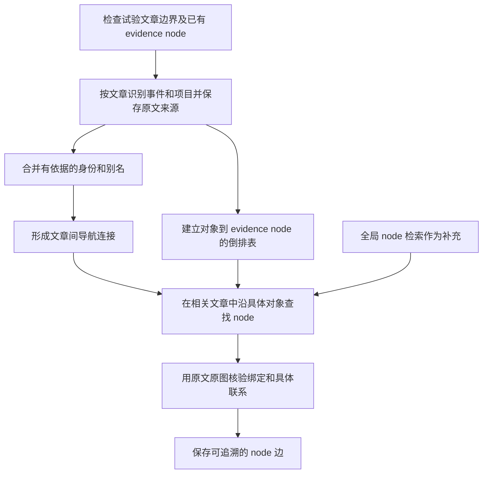

# 实现交接：先建立相关文章索引，再定位跨文章 evidence node

更新日期：2026-10-12。
状态：**设计与实施交接，尚未实现本方案。** 上一轮 article-context pilot 已完成，但不等同于本方案。

## 1. 用户目标与本轮任务

用户希望以 **多模态 evidence node 为最小证据单元**，建立文章内部和跨文章的联系，最终改善检索。
一个 node 可以含段落、公式、表格、图像、图注等成员；不要为了建图把所有模态转换成纯文本端点。

新的实现方向：

1. 从每篇文章的原材料中识别它讨论的具体事件、项目等，保留来源 node 和句段。
2. 基于有来源的共同对象或明确引用，把相关文章挂起来，保存“为什么有关”。
3. 沿这个关联理由，只定位两篇文章中真正承载相关内容的 evidence node。
4. 核验这些具体 node 的联系，再用于图扩展检索。

首先实现小规模可复现试验。第一项问题是：**文章的关联理由能否帮助定位正确的跨文章 node？**
跨文章语义边质量与最终检索收益分别评估，不能以边数增加代替质量证据。

## 2. 从 GraphRAG 借鉴什么

Microsoft GraphRAG 的标准流程从文本单元抽取实体与关系，建立社区，保留回到原文的映射；
局部检索通过实体、关系等找到相关原文片段。它并非默认先建 document-to-document 相似度图。

本方案是面向现有多模态 pipeline 的适配：**文章层负责定位范围，事件／项目等辅助索引负责解释联系，
evidence node 层承载实际证据。** 不要求安装或完整复刻 Microsoft GraphRAG，也不要求首轮做社区检测。

参考官方资料：

- [GraphRAG indexing dataflow](https://microsoft.github.io/graphrag/index/default_dataflow/)
- [GraphRAG local search](https://microsoft.github.io/graphrag/query/local_search/)
- [GraphRAG query overview](https://microsoft.github.io/graphrag/query/overview/)

## 3. 与失败的上一轮有何区别

上一轮主要做了：节点 view 向量均值池化成文章向量 → 选择相关文章 → 向模型加入最多 4 个原文 node 片段。
没有充分建立“文章因什么相连、该理由落在哪些 node、某段背景如何绑定到目标 node”的显式记录。

本轮必须新增可以检查的中间结果：

| 中间结果 | 必须回答的问题 |
|---|---|
| 文章与事件／项目的对应 | 文章在哪个原文位置讨论了哪个具体对象？只是提到，还是报告其结果／应用？ |
| 文章间导航连接 | 两篇文章因哪个确定的事件／项目／引用相关？各自来源在哪里？ |
| 关联理由到 node 的倒排表 | 该事件／项目在每篇文章中由哪些 node 承载？哪些只提供背景？ |
| 指代或图号绑定 | 某个未命名事件的段落／图，如何通过明确原文连接到事件？ |
| node 间候选与核验结果 | 两端各有什么内容？共同对象如何支持联系？有没有借用另一端内容？ |

**不要把改名后的文章向量 top-k + 背景拼接，当成本方案完成。**

## 4. 当前工程与实验状态

仓库根目录：`/hfs2/data/project/hk-project-p0025545/ka_dv3352/Project`。
以下路径相对于仓库根目录。

建议先阅读：

1. `EvidenceNet/experiments/own_corpus_edges/ARTICLE_CONTEXT_PILOT_V1_REVIEW.md`
2. `EvidenceNet/experiments/own_corpus_edges/ARTICLE_CONTEXT_PILOT_V1.md`
3. `EvidenceNet/experiments/own_corpus_edges/FACT_GROUNDED_EDGES_V1_REVIEW.md`
4. `EvidenceNet/experiments/own_corpus_edges/SEMANTIC_GRAPH_RESEARCH.md`

主要数据入口：`EvidenceNet/output/article_context_pilot_v1_20261012/`。

| 文件 | 用途 |
|---|---|
| `units.jsonl` | 已有 550 个 evidence node、成员、原文、bbox、文章归属和 crop 路径 |
| `eligibility.json` | 节点／成员是否参与证据与候选，含 furniture 排除 |
| `reading_edges.jsonl` | 既有阅读顺序边 |
| `assets/` | 原始 crop 等资源，当前为指向上一实验资源的软链接 |
| `article_profiles.jsonl` | 旧文章成员与原文片段，可用于查来源，不能当已验证的完整文章摘要 |
| `pair_contexts.json` | 旧背景片段，含原文位置与哈希 |
| `paired_comparison.jsonl` | 64 对两组完整判断 |
| `audit/accepted_edge_review.jsonl` | 18 条接受边的助手来源复核；不是独立专家标签 |
| `routing_regression.jsonl`、`routing_selections.jsonl` | 旧候选路线的覆盖与预算记录 |
| `manifest.json`、`verification_manifest.json` | 冻结输入、代码及响应哈希 |

当前限制：

- 49 页混合材料，550 个节点，其中 530 个 eligible。
- 550 个节点中 **169 个文章归属未知**；不要误写成 169/530。
- 已有 36 个文章单元：26 个页内单元、10 个按论文文档归属的单元。
- 已有页内单元不等于完整文章。杂志跨页归属仍有缺口，不能把整本杂志当一篇文章。
- 上一轮缓存向量覆盖 494 个 eligible 节点；36 个 eligible TEXT 没有适用向量，其中有标题、短图注，也有角色噪声。
- 原数据含作者／单位等片段；应将其作为元数据或低优先级索引，不能据此伪造具体事件联系。

上一轮结果：不加背景 ACCEPT 23、校验失败 7；加背景 ACCEPT 18、校验失败 11。
有背景的 6 条 CAPTION_FOR 仅 1 条是真图注。候选组合挤掉 108 对文章内候选。
没有证明整体提升，尚未接入正式 pipeline，也未测量检索提升。

## 5. 推荐的数据模型

以下文件名与字段是建议接口，可按仓库风格调整，但必须保留来源、阶段状态与不确定性。
示例 ID 是占位符，不是已有数据中的实际 ID。

### 5.1 文章单元

`articles.jsonl`：

- `article_id`、`document_id`、`node_ids`、`pages`。
- `boundary_status`：完整归属已确认／页内片段／未知。
- `coverage`：此次实际覆盖的页与缺页情况。
- `title` 及其来源；原文标题与模型推断标题分开。

先复用可靠归属，再为试验子集检查边界。未知归属保持未知，不通过语义相似度强行并入文章。

### 5.2 事件／项目索引与来源记录

`subjects.jsonl` 保存规范 ID、类型、名称和有依据的别名。
首轮重点 `EVENT`、`PROJECT`；具体方法／数据集可后续加入。宽泛主题用于弱召回。

`subject_mentions.jsonl` 每条保存：

```json
{
  "subject_id": "EVENT:GW150914",
  "article_id": "ARTICLE_A",
  "node_id": "NODE_A1",
  "role": "reports_detection",
  "source_mention": "GW150914",
  "source_anchors": ["ANCHOR_A1"],
  "binding_status": "DIRECT_MENTION",
  "review_status": "UNREVIEWED"
}
```

要求：

- `canonical_name` 与 `source_mention` 分开。原始字符位置和哈希保留，不用规范化名字反写原文。
- 别名合并须有证据；同名机构不等于同一事件，单独的 LIGO/CERN/CMS 名称不自动绑定具体研究。
- `role` 说明内容用途，如检测、参数估计、项目实施、仅提及、一般背景。
- 不要求所有节点先抽成完整主谓宾事实，也不要求断言的语法主体恰好属于 EVENT/PROJECT。
- 对抽取不足、截断、未覆盖成员分别记录，不能把空结果解释成无关系。
- 每篇的来源记录独立产生，不能先看到另一篇结论再倒填本篇证据。

### 5.3 文章间导航连接

`article_navigation_edges.jsonl`：

- `source_article`、`target_article`。
- `basis`：如 `SHARED_EVENT`、`SHARED_PROJECT`、`EXPLICIT_CITATION`、较弱的 `TOPIC_CANDIDATE`。
- `subject_id` 或引用标识。
- `source_mention_ids`、`target_mention_ids`；引用方向单独保留。
- `strength`／排序分数、`status`、两端来源覆盖。

这层含义是“可沿此理由查找另一篇的证据”，不能自动推出任意段落之间支持、因果或解释关系。
引用边证明文献间引用；被引用文章中的具体目的 node 仍需匹配。
共同机构、宽泛主题不能与有明确事件身份的连接使用相同强度。

### 5.4 上下文消解记录

`context_bindings.jsonl`：

- `target_node_id`、待消解的图号／代词／省略对象。
- `resolved_subject_id`。
- `binding_basis`：如文章内唯一 Fig.1 引用、明确相邻指代、已确认 caption-to-asset 归属。
- `target_anchors`、`context_anchors`、推导说明及不确定性。

`local_content` 与 `context_resolved_content` 分开保存。背景中的质量数值不能伪装成目标图注原文。
图号要限定到文档与文章；不同论文的 Fig.1 不是同一图。同文章也不代表所有 node 都陈述同一事件。

### 5.5 node 候选与最终边

`node_candidates.jsonl` 保存两端 ID、关联理由、两端绑定来源、候选路线与分数。
`node_edge_decisions.jsonl` 保存接受／拒绝／不确定／处理失败，以及完整判断依据。

可把经核验的共同对象联系表示为：

```json
{
  "source": "NODE_A1",
  "target": "NODE_B4",
  "relation": "RELATED_VIA_SUBJECT",
  "subject_id": "EVENT:GW150914",
  "source_aspect": "detection_significance",
  "target_aspect": "source_mass_estimation",
  "source_binding_id": "BINDING_A1",
  "target_binding_id": "BINDING_B4",
  "status": "ACCEPTED_FOR_NAVIGATION"
}
```

这只表达“两端具体内容经来源核验关联到同一对象”，不包含支持、因果、数值相等或信息互补的承诺。
是否有检索增益仍需评测。明确的重复内容、机构索引、背景提及与具体证据要分别记录。
不要为了填满一个固定枚举，把正文升成 caption 或把相关工作列表升成定义。

## 6. 建图与检索流程



实施顺序：

1. **prepare**：冻结试验文章、节点、资源及边界记录，保存哈希。
2. **index_subjects**：逐篇生成事件／项目来源记录，规范身份；先检查文章级连接是否合理。
3. **bind_nodes**：直接提及与有证据的上下文消解形成 node 倒排表；图表保留实际 asset 来源。
4. **propose_pairs**：只在相应对象的相关 node 集合中生成有限候选，避免两篇文章的全部段落笛卡尔积。
5. **verify_pairs**：两端独立检查本地内容与消解依据，再决定是否成立；必要时用原图。
6. **report**：输出候选覆盖、错误实例、来源可追溯性、处理失败，以及可浏览的关系链。

embedding 用于找相近文章／对象／段落和排序；Qwen 用于限定范围内的角色、指代和图文判断。
程序校验负责 ID、来源归属、哈希、局部与上下文锚点分离，不能把语法通过视为语义正确。

候选预算必须明确：

- 文章内阅读顺序、图文归属和明确引用作为独立结构路线保留。
- 跨文章候选比较使用相同总预算；文章路线与全局 node 路线各自用量明示。
- 单独统计 directed proposal 与去重 node pair，不能混用计数。
- 文章未知、对象未抽出或缺向量的 node 仍有全局／词汇候选入口，并报告覆盖缺口。
- 不允许新增跨文章候选默默挤掉既有文章内结构关联。

**避免循环证明**：文章导航连接独立来自两篇原文；最终 node 边另外核验。
如需要从 node 边聚合最终文章证据图，另存 `article_evidence_edges.jsonl` 并保存 supporting_edge_ids。
不得用同一条文章候选边证明 node，再用该 node 回证文章候选已正确。

## 7. 多模态与来源约束

- 图片、图表和公式仍属于原 evidence node，原图必须可访问。
- 生成描述可用于召回，不可冒充原文或原图观察。
- 图注已在 node 内部时，内部 caption→visual 关系不是跨 node 的 edge。
- 判 CAPTION_FOR 要检查实际图注来源、布局／asset 归属及另一端原图。正文描述图片不等于图注。
- 跨文档图注需额外证明所指图像身份；相同 Fig.1 标签或相似主题不足。
- 不自动把 B 的锚点换成 A 来修 schema。此类错误经常是真实的端点混淆。
- footer、页码、导航／logo 不进入证据；标题可参与索引和分组，但裸标题不能直接充当实质定义。
- 保留时间、否定、条件、单位、参考系。GW150914 detector-frame 与 source-frame 数值不同不能自动判矛盾或相等。

## 8. 第一轮试验范围与已知案例

建议选 **8–12 篇边界确认的文章或明确标识的文章片段**，先核对实际材料是否足够。
覆盖 GW150914 论文、AHEAD 材料、CERN 同机构不同事项等。
若 AHEAD 只有同一文章的不同分组，不能为了凑跨文章正例把它们假装成独立文章。
不同材料的纯弱主题样例也应保留，避免只验证有唯一事件名的容易样例。

冻结约 20–30 对正负与不确定的 node 开发案例，另留未用于调试的案例。
旧助手审查只用于开发，不当成独立专家标签；新案例需核对来源后再定预期。

以下 ID 在旧 `paired_comparison.jsonl` 中可查到实际 node 和原文：

| 案例 ID | 用途／预期 |
|---|---|
| TYPED_08073 | 关键消解正例：GW150914 原文明确指 Table I and Fig.1，绑定无事件名的质量 posterior 图。保留上下文来源。 |
| TYPED_08362 / 08365 | GW150914 检测／GR／参数联系，注意参考系。 |
| TYPED_04439 / 04478 | AHEAD 项目原文明确联系；检查真实文章边界再确定 scope。 |
| TYPED_01886 | UMBRELLA 与支持它的 CAFEIN 内容；文章归属需先确认。 |
| TYPED_05820 / 05882 | 通用 LIGO 阈值／设计噪声不能因机构相同升级成 GW150914 事件证据。 |
| TYPED_00558 | Nobel 图注与另一年份不同人像的跨文档误绑。 |
| TYPED_03527 | 机械振子图与电网减排图注的错误跨图关联。 |
| TYPED_05306 | 相关工作列表不构成定义；同主题可能只是弱候选。 |
| TYPED_07990 | C3 定义与具体分类实例，不把通用定义冒充同一事件陈述。 |
| TYPED_03252 / 07491 | 文章内项目／公式关联，检查新路由是否挤掉原有候选。 |

注意历史更正：TYPED_05226 的 classification 原图含 CNN 架构和类别样例，不能简称分类树，
也不能把它与分割图的所有联系一概判无效。类型和具体机制应重新检查。

## 9. 评估与验收

第一轮只比较：

- 相同节点输入、相同跨文章预算的全局 node 召回。
- 本方案的文章关联理由 + node 定位，保留明确预算的全局补充。

两组使用一致的核验规则、模型与样例。分别报告：

1. 文章关联理由的来源正确性；泛机构／主题误连数。
2. 已知跨文章有效 node 对召回、错候选与无向量／未知归属覆盖。
3. 每篇／每事件候选数、核验调用数、用时和去重情况。
4. 最终边的来源与类型错误，分别检查接受和拒绝侧。
5. 文章内结构路线是否保留；处理失败不能计为正确拒绝。

通过条件分两层：

- **工程完成**：阶段可恢复、输入冻结、全链来源可追溯、失败可见、测试和回归可重放。
- **方法有收益**：在固定样本与预算下有来源支持的召回改善，且误连、遗漏和核验成本可接受。
  具体阈值在看新结果前约定并写入 manifest；不能结果出来后改口径。

随后才能冻结 20–30 个查询及相关证据，与 evidence-only 检索比较 Recall@k／nDCG 等。
当前自有材料 edge 试验与 VL-DocIR 冻结 baseline 分开；未运行查询评测时不要宣称检索提升。

## 10. 可复用代码与运行环境

| 入口 | 可复用部分／注意事项 |
|---|---|
| `EvidenceNet/scripts/run_article_context_pilot.py` | 输入冻结、两组对照、报告、原文上下文位置；其均值文章路由与背景拼接不是新方案本体 |
| `EvidenceNet/scripts/run_typed_node_edges.py` | `catalog`、`request_targets`、原文／原图锚点；`entities` 有 for the 等噪声，需检查 |
| `EvidenceNet/scripts/run_node_context_edges.py` | 文件读写、哈希、view embedding、候选框架；`scope` 跨页判定需对照真实文章身份 |
| `EvidenceNet/scripts/node_context_policy.py` | eligibility 与结构候选；检查 furniture、短标题等覆盖 |
| `EvidenceNet/scripts/verify_node_context_v3.py` | 原文 span 与成员排除规则 |
| `EvidenceNet/scripts/run_own_corpus_edges.py` | Qwen 模型加载、文章归属与阅读边流程 |
| `EvidenceNet/scripts/run_fact_grounded_edges.py` | JSON 调用重试等小工具；不要恢复成所有边必须先抽完整事实的流程 |

建议新建实验脚本／模块，保持旧实验可以解释与复现。输出使用新的实验目录。
目录和 schema 是建议；实现时先检查当前仓库状态及本地规则。

本机可用环境（接手时再核实）：

- GPU 推理：`EvidenceNet/.venv_qwen/bin/python`；该环境此前没有 pytest。
- 测试：`.venv-magazine-exp1/bin/python -m pytest`。
- 环境配置：`source current/env.sh`，本地模型缓存为离线模式。
- 模型：`external/models/Qwen3.5-35B-A3B`。
- embedding：`EvidenceNet/models/Qwen3-Embedding-0.6B`。
- 旧缓存：`EvidenceNet/output/node_context_edges_v2_20261011/views.jsonl` 与 `view_vectors.npy`。
- 提交器示例：`current/slurm/edge_generation/article_context_compare_gpu.sbatch`。
  旧运行配置为 2 GPU、160 GB、3 小时时限；按新试验工作量与当时队列选择资源。

Slurm、结果 JSON、大型数据与模型按现有仓库忽略规则管理；文档、源码及必要配置保持可提交。
不覆盖既有输出、不清理无关改动、不重新解析全数据或重跑 node generation 来完成此小试验。

## 11. 给接手模型的起步任务

1. 核对上面的输入、原文及文章归属，列出可用的 8–12 个单元，不足时如实缩小样本。
2. 先实现最小对象索引、来源绑定和文章导航连接，并输出可人工检查的中间表。
3. 选 GW150914 的 Fig.1 消解链验证从文章到多模态 node 的完整路径，同时跑 LIGO 通用背景负例。
4. 补齐固定预算的全局对照和文章内候选保护，再扩到冻结开发集。
5. 保存运行参数、输入／代码／模型标识、每阶段结果和失败原因，检查接受与拒绝两侧。
6. 用报告说明方法是否有收益；若失败，指出失败发生在边界、身份合并、node 定位还是最终判断。

首轮交付应包含：可运行代码、必要测试、新实验清单、文章导航图、对象到 node 映射、
有来源的候选／决定、对照报告。可视化至少能展开“文章关联理由 → 两端 node → 原文／原图”。
