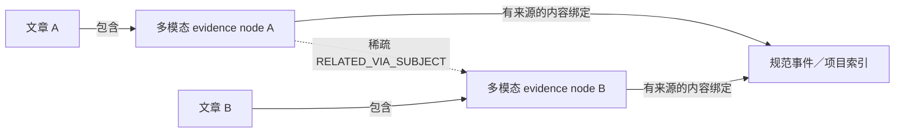

# Article bridge：结合实验与论文的下一步建议

日期：2026-10-12。依据 GPU 69626 的冻结结果、当前实现和下列原始论文。本文提出待验证方案，不代表这些方案已在我们的数据上取得提升。

## 1. 这轮实际检验了什么

最关键的发现：当前不是完整的 article-first retrieval。
`run_article_bridge_pilot.py::route` 先使用全局 node 排序，把共享精确 subject key 的目标提前；`propose` 在 node 候选之后才生成 `article_navigation_edges`，文章导航图没有被路由消费。因此不能把本轮结果解释成“先选相关文章再定位 node 没有价值”。

215 个 eligible node 中，仅 7 个候选集合变化、14 个顺序变化。两组每个 node 都有 8 个有向目标，预算一致；无向去重后 1383/1387 的差异并非预算不公平。联合候选 1391 对，其中 1379 对相同。

另外，32/44 对缺少 shared binding；程序要求它们只能 UNCERTAIN。实际得到 21 UNCERTAIN 和 11 状态协议冲突。其余 12 对有 binding，得到 11 ACCEPT 和 1 个来源审查发现的错拒。当前核验强烈依赖建图阶段的绑定覆盖，不能独立衡量一般语义关系的精度。

全部 3 条文章导航边、8 个 subject 独有候选都来自三篇 GW150914 论文。新增 5 对已核验案例的 4 接受／1错拒是局部积极信号，缺少独立事件／项目的重复验证。详见 [本轮来源审查](ARTICLE_BRIDGE_PILOT_V1_REVIEW.md)。

## 2. 论文中值得借鉴的具体部分

| 论文 | 已核实的内容 | 对本项目的启发与边界 |
|---|---|---|
| [HippoRAG 2 — From RAG to Memory (2025)](https://arxiv.org/html/2502.14802) | 将原始 passage 与 phrase 节点共同放入图，结合 query、稠密检索和 Personalized PageRank；相关方法见 §3.2–3.5。 | 保留 evidence node 的完整上下文，主体索引承担导航；以后让 query 决定扩展方向。直接采用本文完整 OpenIE/KG 系统不是当前建议，尤其不恢复所有边必须先抽完整三元组的流程。 |
| [SciCo — Hierarchical Cross-Document Coreference for Scientific Concepts (2021)](https://www.akbc.ws/2021/assets/pdfs/OFLbgUP04nC.pdf) | 区分同指、概念层级及无关，模型使用 mention 所在段落；见 §4.2。 | 原文名称与规范身份分开。用带上下文的身份判断替代字符串相等，同时区别“同一项目”和“项目相关”。这是借鉴任务划分，非宣称 SciCo 已解决我们多模态项目消歧。 |
| [ColPali — Efficient Document Retrieval with Vision Language Models (2024)](https://arxiv.org/html/2407.01449) | 用页面图像的多向量表示进行 query–page late interaction 检索；见 §4–5。 | 给原始图片／表格保留直接视觉召回通道，描述 text 作为补充。页面检索结果不能直接证明 evidence crop→crop 连边正确，必须另测。 |
| [GraphRAG — From Local to Global (2024)](https://arxiv.org/abs/2404.16130) | 从实体图及社区摘要支持面向整个语料的全局问题。 | 它不是默认的 document→document 相似度图；全局概括收益不等于我们的细粒度证据检索收益。 |
| [RAPTOR (2024)](https://arxiv.org/abs/2401.18059) | 对文本块递归聚类、摘要，构建多层检索树。 | 可借鉴上层导航、下层原文证据的分工；摘要只用来找候选，不能填补 evidence node 本身没有的断言。 |

优先研究 HippoRAG 2 与 SciCo；ColPali 作为多模态召回的后续独立比较项。论文任务、语料及评测与我们不同，以上启发均需本地对照验证。

## 3. 最值得尝试的算法改造

### 3.1 先独立验证 node→subject，再派生弱 node-to-node edge

保持 evidence node 为最小证据单位，主体仅作辅助索引：

验证每个 node 是否真的提供该具体主体的内容，分别记录本地原文／原图、角色、方面、条件以及必要的上下文指代来源。仅出现名字、作者单位、通用背景不满足内容绑定。

若两个可靠绑定指向同一已消歧主体，就可以在候选预算内派生弱 `RELATED_VIA_SUBJECT`。这符合当前关系定义；无需再让模型逐对决定“不同分析方面算不算同一事件”。现有 `BRIDGE_a474afc1b03d` 的错误拒绝正是额外判断产生的门槛。

`SUPPORTS`、`CONTRADICTS` 等更强关系仍需专门的两端证据验证；共同主体不能推出它们。弱关联也不保证对任何 query 都有帮助，需要后续检索选择。

这只是下一轮假设：会降低重复 pair 判断，但也可能放大错误的主体绑定。因此必须同时检查绑定精度、错误传播和实际调用成本。不要把同一主体下所有 nodes 展开成完全图；保留辅助索引，按预算生成稀疏边或在查询时展开。

### 3.2 将原文名称与身份分开

保存 `mention_surface` 原始拼写与 offsets，另给出稳定的 `canonical_subject_id`。alias 本身也要有来源／理由。

- AHEAD 与 AHEAD project：在原文与文章上下文支持时归到同一身份。
- UMBRELLA 与 the UMBRELLA project：同样处理。
- UMRELLA：原始 OCR 拼写保留；有可靠同文章来源时建立 alias。
- CAFEIN 与 UMBRELLA：不能因为它们合作或处于同一段就合并；“支持某项目的平台”和“项目本身”是两个对象。

embedding／编辑距离仅产生 alias 候选；同名缩写、不同时间／项目的冲突必须阻止直接合并。优先解决上述明确回归案例，再考虑 METHOD／PLATFORM 等类型，避免同时改变过多变量。

同一 `(node, subject)` 保存来源列表，避免当前最后一次字典赋值覆盖以前的直接／上下文绑定。对解释优先使用已保存的来源链模板，而不是让模型再自由生成跨文章引用关系。

### 3.3 让文章导航真正影响候选分配

保持每源 node 最多 8 个跨文章目标，可做一个小对照：

1. 保留 global top-4。
2. 剩余 4 个槽位先沿经过来源支持的 subject 找相关文章。
3. 从至多 2 篇文章各选最多 2 个有有效 subject binding 的 target，兼顾相关性与内容方面的差异。
4. 去重，不足用 global 填充；文章内阅读／结构路线独立保留。

文章导航须先生成并被候选生成器实际消费。不能为了让候选不同而强行引入弱节点；评估的是新增正确覆盖及是否挤掉原有正确结果。2篇×2node 配额是待测起点，不是论文已证明的最优参数。

事件／项目很少时，单改这一步的收益仍然受绑定覆盖限制。本轮 48 条 substantive binding 只有 27 个唯一 node-subject；应同时报告覆盖和去重，避免被重复绑定数误导。

### 3.4 评测不以算法自己的索引成功为真值门槛

将 `binding_coverage`、`semantic_decision`、`protocol_valid` 分开。无绑定表示算法尚未建立此关系，不等于来源一定不支持，也不等于所有 REJECT 都是格式错误。

独立的来源标签应从原始两端证据与允许的来源上下文判断，不依赖某个算法是否已输出 shared_subject_id。这样才能区分路由漏召回、身份漏合并、绑定失败和最终关系判断错误。

另外，当前 cosine 与缺向量 node 的 Jaccard 直接混合排序，不保证尺度可比。可使用独立排序后的融合／明确通道配额，并单独报告缺向量节点的覆盖；不宜仅说“有 fallback”就视为问题解决。

## 4. 建议的推进顺序

先用同一冻结数据逐项检查，避免同时替换模型和多个算法：

1. **CPU replay：身份与协议。** 对保存的 mentions 做可追溯 alias 合并；重点重放 04478。另拆分 11 个状态冲突，保留模型原始答案，不能通过重分类伪造质量提升。
2. **小规模绑定实验。** 独立核验本轮涉及的 node→subject，派生弱边；覆盖误拒 a474afc1b03d、跨论文 Fig.4/Fig.1 引用错误、detector/source-frame 条件遗漏及通用 LIGO 背景负例。
3. **同预算文章路由。** 在第二步绑定冻结后，对比全局 top-8 与文章导航＋回退，先完成 CPU 候选差异检查，再核验新旧差异及漏掉的正例。
4. **增加独立主体簇。** 从自有 corpus 选多个事件／项目，每簇至少两篇真正独立但相关的文章；不能把同篇文章的分页或侧栏当独立样本。按主体簇留出测试，避免同一 GW150914 的多个 node 同时充当开发和“独立”测试。
5. **冻结查询，检验用途。** 先用约 20–30 个经过来源核对的开发查询，覆盖单 node、跨文章和多模态需求；每个 query 的相关 evidence 标签不由待测图决定。以同样的最终证据数／上下文预算比较 evidence-only 和图扩展，记录 Recall@k、nDCG、噪声比例和额外开销。小样本结果用于诊断，不作强泛化结论。

总体判断：值得继续做的是“带规范身份和原文绑定的稀疏证据图”。下一步优先改善绑定与路由，明确弱关联的用途，再考虑图传播或视觉检索模型的扩展。
