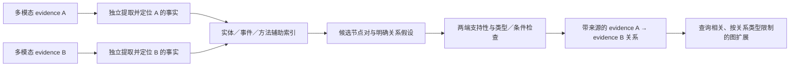

# 从 typed-edge 结果到语义与图方法的研究笔记

整理日期：2026-10-12。基于 `typed_node_edges_v1_20261012` 的实际输出、
源码与原始论文。下面的迁移方案是研究假设，尚未在本项目验证。

## 实验说明了什么

320 对已处理，192 条模型接受边与 14 条原文引用边构成 206 条语义边。
跨文档 36 条边对应 33 个节点对。助手来源复核分为 15 条较可信内容对应、
14 条低价值／不充分关联、6 条明确不支持、1 条重复资产；并非独立人工金标。

需要修正此前把问题概括为“接受门槛太松”的说法：

- **关系定义问题**：当前 SAME_ENTITY 明确允许 organization/object。
  Microcosm 与 BASE-STEP 共用 CERN（00460、00501）、不同测量共用 ATLAS
  （00942）可能符合当前定义；其直接用于检索扩展的价值尚未证明。
  不能把这些一律算作模型语义错误。CERN 出现在 21 个节点，LIGO 出现在 19 个，
  将实体共现投影成 evidence pair 会产生很多泛关联。
- **事实归因问题**：00270 把 B 的 CAFEIN／卒中事实说成 A 也有；05813、06144
  把一般 LIGO 条件升级为具体 GW150914 事件。锚点存在检查没有验证关系命题。
- **类型路由问题**：04532 的图注／原图只能被判 EXPLAINS；07990 的定义／实例
  原始语义判定为 REJECT，再因 direction=NONE 变成 FORMAT_PENDING。
  修复格式不会自动恢复 C3 漏边。
- **协议问题**：30 个格式失败中 20 个为 REJECT 没填方向；64 次复判的 14 个
  分歧中，8 个为格式失败，只有 6 个是有效语义状态变化。

旧 6 个较可信案例全部恢复是开发集回归结果；旧漏边 5/10 有边不能称为
召回率，因为其中 4 对没有进入判断队列。检索收益仍待固定查询测量。

## 优先阅读的语义论文

### 1. Linear Cross-document Event Coreference Resolution with X-AMR

Ahmed et al., LREC-COLING 2024。
[原论文](https://aclanthology.org/2024.lrec-main.920/)

论文用围绕单个 mention 的事件图表示谓词、参与者、时间地点，再进行跨文档
共指。启发：为每个 evidence node 独立抽取事件／事实记录，再比较事件身份；
使用同一仪器不能推出发生同一事件。自动抽取仍是瓶颈，新闻事件结果不能直接
外推到科学文档。我们的事实记录还必须保留否定、模态、单位与参考系。

### 2. Label Verbalization and Entailment for Effective Zero and Few-Shot Relation Extraction

Sainz et al., EMNLP 2021。
[原论文](https://aclanthology.org/2021.emnlp-main.92/)

论文把关系写成明确自然语言假设，以文本蕴涵模型判断原文是否支持；无关系
识别仍然困难。我们的扩展设想：先独立检查 A 是否支持 fA、B 是否支持 fB，
再判断 fA 与 fB 的具体关系。双端隔离是本项目建议，不是论文已验证的方案。
普通文本 NLI 不能直接核验原图，也需要适配 OCR 和科学材料。

### 3. Eider: Empowering Document-level Relation Extraction with Efficient Evidence Extraction and Inference-stage Fusion

Xie et al., Findings ACL 2022。
[原论文](https://aclanthology.org/2022.findings-acl.23/)

论文联合提取关系和证据，推理时融合证据子文档与全文预测。
适合借鉴到 UMBRELLA：完整成员找事实，再定位短证据；证据不足时回看节点
全文，避免只选开头片段而漏掉后面的项目说明。原方法研究文档内实体关系，
没有验证我们的跨文档多模态边。

### 4. Dense X Retrieval: What Retrieval Granularity Should We Use?

Chen et al., EMNLP 2024。
[原论文](https://aclanthology.org/2024.emnlp-main.845/)

论文将简洁、自包含的原子命题作为检索表示，研究不同索引粒度。
我们可为一个 evidence node 生成多个有来源的事实检索视图，分别召回，再映射
回原 evidence node。事实视图不成为新的最小证据节点。命题改写可能失真，
尤其是限定条件与视觉描述，仍需原文／原图核验。

### 5. Cross-media Structured Common Space for Multimedia Event Extraction

Li et al., ACL 2020，WASE/M2E2。
[原论文](https://aclanthology.org/2020.acl-main.230/)

论文通过文本语义结构与图像事件／参与者角色实现跨模态事件抽取，并保留
文字或图像区域定位。可借鉴“角色＋原始区域”的表示：视觉内容记录对象、
图例、坐标轴、流程和测量，而描述只用于检索。原实验主要是新闻照片与有限
事件类型，科学图表／公式需要单独适配。

## 优先阅读的图与检索论文

### 6. From RAG to Memory: Non-Parametric Continual Learning for Large Language Models

Jiménez Gutiérrez et al., ICML 2025，HippoRAG 2。
[原论文](https://arxiv.org/html/2502.14802v1)

论文保留 passage 节点与短语图，利用查询到三元组的匹配、筛选与 Personalized
PageRank 检索。启发是保留原证据上下文，实体作为辅助入口，查询匹配具体事实。
我们可用多模态 evidence node 承接 passage 的角色；这是迁移设想，文本 QA
结果不是本项目多模态检索的保证。错误图上的传播仍可能扩大错误。

### 7. PathSim: Meta Path-Based Top-K Similarity Search in Heterogeneous Information Networks

Sun et al., PVLDB 2011。
[原论文](https://vldb.org/pvldb/vol4/p992-sun.pdf)

论文用节点／边类型构成的 meta-path 定义不同语义的结构相似性，并进行
路径规模归一化。最直接的启发是区分 evidence→事件→evidence 与
evidence→机构→evidence，分别决定能否用于检索扩展。
PathSim 不是语义真实性判别器，且对称相似度不能替代有向解释关系。

### 8. HippoRAG: Neurobiologically Inspired Long-Term Memory for Large Language Models

Jiménez Gutiérrez et al., NeurIPS 2024。
[原论文](https://arxiv.org/html/2405.14831v1)

论文用实体出现段落数的倒数作为 specificity，调整检索起始权重。
可借鉴高频背景实体降权，但将该项用于 evidence 边权是我们的改造。
稀有 OCR 错字也会得到高稀有度，因此频率不能代替事实校验。

### 9. Knowledge Graph-Guided Retrieval Augmented Generation

Zhu et al., NAACL 2025，KG²RAG。
[原论文](https://arxiv.org/html/2502.06864v1)

论文从语义检索种子沿知识图有限扩展，再按查询相关性组织上下文，使用最大
生成树减少组织阶段冗余。可借鉴查询驱动的 evidence 扩展，不必预先把全部
共享机构的节点连成强关系。树能选择边，不能证明边真实；也不应拿来裁掉
整个证据库中合法的多种关系。

## 进一步的灵感

- [A Rationale-centric Counterfactual Data Augmentation Method for Cross-Document Event Coreference Resolution](https://aclanthology.org/2024.naacl-long.63/)，NAACL 2024：
  针对表面相似偏差构造反事实训练样本。可先借鉴为诊断集：同仪器不同事件、
  同项目不同措辞、同事件不同参考系；合成样本需核查，不能当真实语料。
- [Extracting the multiscale backbone of complex weighted networks](https://arxiv.org/abs/0904.2389)，2009：
  按节点局部权重分布与空模型筛选显著连接。以后可研究局部稀疏化，避免单一
  全局阈值。统计显著性不是语义正确性；当前任意相似度和 LLM 自报置信度
  不宜直接当作可靠边权。
- [HyperGraphRAG: Retrieval-Augmented Generation via Hypergraph-Structured Knowledge Representation](https://arxiv.org/html/2503.21322v3)，2025：
  用超边表示多元事实，以二部图存储实体与事实。启发是保留事件、量、值、
  条件的联合绑定。用带属性的事实记录也可先实现，不必立刻重写图存储；
  该论文的多模态扩展属于未来工作。

## 建议的最小架构改动

端点、检索结果和引用仍然是现有多模态 evidence node。附加记录保存：

`事实ID、对象/事件、谓词、参与角色、条件/时间/参考系、原文span或原图区域、证据node ID`

每个节点独立抽取与验证，避免在初次抽取 A 时看到 B 并补入 B 的事实。
不在本节点中可见的推断保留为待解指代，不能直接声称已被本节点支持。
外部文章上下文若参与消歧，应额外保存来源。

实体共现可用于候选召回，正式边则区分同一具体事件、方法说明与应用、
定义与实例、图注与图、可比较测量等。支持／冲突关系必须检查命题和限定条件，
不能只因实体相同或数值不同就推断。共享组织保留为辅助联系；涉及组织本身
的查询仍可使用，不需要一刀切删除 CERN/LIGO。

候选路由仅提供线索，不锁死最终关系类型。图的阅读顺序层保持独立；
文章关系继续由有出处的节点边汇总，并保留文章归属不确定性。

## 下一轮最有辨别力的检查

先固定同一批候选，对比当前成对判断与“独立事实提取→关系核验”。选择本轮
明确错例、此前有效关系、未抽中的漏边、不同模态和独立保留的新文档案例。
开发错例与保留案例分别报告；固定候选的对照用来定位改善来源。

至少分别记录事实支持、类型/方向、背景共现、无关系、弃权、格式失败；
检查漏边到底在候选、抽样还是判定阶段。后续检索用固定查询和相同返回预算，
比较 evidence-only baseline 与图扩展的新增相关节点、错误扩散及 Recall/nDCG。
边数增加、图更连通或同模型复判一致都不能替代检索评测。

阅读顺序建议：X-AMR → EIDER／关系蕴涵 → PathSim → HippoRAG 2；
多模态部分单独参考 WASE。先验证事实表示和关系定义，再决定是否训练专门模型。
