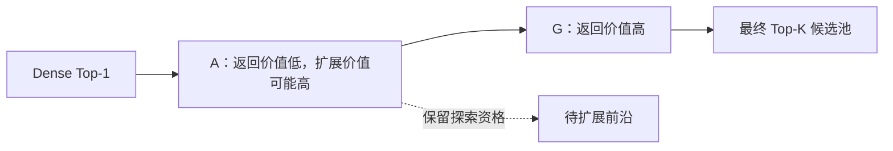

# DynamicEdgeGraph：自适应预算与多跳检索方案

日期：2026-11-14。仅为设计与后续实验建议；本次没有修改代码、数据、冻结图或旧实验结果。

> **最新简化：按用户建议，第一版直接采用固定硬预算停止，不训练 stop，也不要求预测证据充分后提前停止。第 6.1–6.3 节补充多节点问题的集合选择：预算控制搜索，最终 K 个名额按互补检索价值分配。动作收益与 X 的学习仍是后续可选增强，不是起步前提。**

## 1. 用户最新需求

最终仍只提供 Top-K 检索结果。希望允许两个变化：

1. 若 Edge 候选优于后续 Dense 候选，剩余结果名额可全部给 Edge，不固定 Dense/Edge 比例。
2. 允许 `Dense Top-1 → A → G`；A 本身可能不适合返回，但它的邻居 G 才是相关目标。

推荐整体结构：**固定预算的多前沿搜索 + 考虑已选集合的检索评分**。保留返回价值与探索价值的概念区分，但第一版可以使用固定调度规则，不必先学习 X 或停止策略。原来的 `2 Dense + 2 Edge` 保留为易解释的对照，A/E 继续用作检索信号，不引入完整答案生成或回答验证系统。

## 2. 先把结果名额和计算预算分开

| 符号 | 含义 | 例子与边界 |
|---|---|---|
| K | 最终返回多少个不同 node/page | K=5，不等于只看 5 个节点 |
| K_keep | 若沿用先前保护策略，固定保留多少个初始 Dense 结果 | 先保持 2，其余 3 位自由竞争；不声称这 2 个必相关 |
| B | 搜索/评分总预算 | 独立计入候选粗排、内容读取、重排、图像和模型调用 |
| H | 从初始 seed 出发的最大边数 | seed 深度 0，A 深度 1，G 深度 2 |
| b | 每次扩展最多提议多少个新邻居 | 分小批展开，不能一次读完整个大邻域不计费 |

最终结果名额用于选择返回项；搜索预算用于发现可返回项。A 会消耗搜索预算，但不必占最终 K 个名额。若 A 本身也是必要检索证据，也允许按返回分进入结果，不能一概排除所有中间节点。

如果所谓总预算真的只允许接触 5 个节点，则任何中间节点都会挤占搜索其他目标的机会；算法不能把路径成本消除。报告时必须说明预算到底是最终页面数、已评估 node 数、实际 token/图像量还是延迟。

## 3. “Edge 比 Dense 高”有两个不同判断

### 3.1 已经评分的候选：比较统一的返回分

对已访问候选，使用共同的返回评分接口：

\[
R_\theta(q,v,\text{可用 route 信息}).
\]

Dense 与 Edge 候选都使用相同的相关性、局部 answerability、潜在 evidentiality 标准。无 route 的候选有显式缺失标记，不强制得低分；多个 route 不重复累加概率质量。若 route 是加分特征，要在包括 Dense 候选的训练/开发分布中校准，不能固定给“有边”正奖励。

因此，如果剩余三个最优候选都来自图，最终允许 `2 个保留 Dense + 3 个 Edge`。每次找到新候选都可以更新尚未固定的名额，不按发现先后锁死结果。

不要直接比较 Dense cosine=0.7 与独立 Edge classifier=0.9。它们不是天然可比的概率。同一个 backbone 也不自动保证分支间可比，需要共享训练目标、相当的内容读取规则和开发集检查。

### 3.2 尚未访问的候选：比较下一步搜索的预计收益

“已经发现的 Edge 目标分高”不能直接推出“剩下所有 Edge 都值得搜索”。下一步比较的是：继续处理 Dense 队列，还是展开某个 frontier 的邻居，哪一个更可能改善当前结果。

可以用如下决策目标描述：

\[
a^*=\arg\max_{a\in\{\mathrm{DENSE\_NEXT},\mathrm{EXPAND}(v)\}}
\frac{\widehat{\Delta U}(q,a\mid\text{已见候选、剩余预算})}{\widehat c(a)}.
\]

这里 ΔU 是预测的结果改进，c 是预计成本；不是提前知道 Gold 后算出的收益。跨多个步骤的潜在收益可进入预测，因此不要求扩展 A 的立即回报为正。这个贪心形式是实用启发式，不保证有限预算下的全局最优，尤其多证据目标可能有组合效应。

初版可以在固定批大小/内容预算下用一个共同的动作优先级近似，不必先实现精确概率模型。每执行一小批就重算优先级；若 Edge 连续有较高收益，可连续把预算投入 Edge，但不因第一次高分提前锁定所有剩余预算。

## 4. 节点必须有两种不同价值

| 分数 | 回答的问题 | 主要依据 |
|---|---|---|
| 返回分 R | 当前节点是否值得放进最终 Top-K？ | query 匹配、局部 A/E、有效连接上下文、可选的重复覆盖特征 |
| 扩展价值 X | 从当前节点继续展开，在剩余预算/深度内是否可能找到更好的目标？ | 已见实体/引用/关系线索、允许使用的索引特征、路径与访问记录、当前结果门槛 |

R 低而 X 高是必须允许的状态；也可能 R 高而继续展开没有价值。A/E 主要帮助 R，对桥接线索的支持可以辅助 X，但不能把直接答案 A/E 的低值作为禁止扩展的门槛。

运行时不会知道 G 是 Gold；图中的 Gold 身份只用于解释或离线评价。系统必须凭当时可见的 A 与连接线索估计 X。路径中前一节点的低分不应通过逐跳乘法把后续候选永久压成零。

X 不能免费读取未访问邻居的完整内容。如果模型使用邻居 embedding、缓存摘要、类型或边元数据，明确这是离线索引还是在线访问，并计入对应索引和查询成本。如果已经读取并重排了所有后继再选一条，则那些后继全部算已评估，不能只记最终胜出路径。

## 5. 最小运行算法：多前沿的优先搜索

维护四项显式状态：Dense 剩余队列、已发现且可继续展开的 frontiers、已评分去重候选池、预算与访问记录。状态不包含 Gold answer 或测试相关性标签。

1. **初始化。** 从冻结 Dense 检索获得队列与少量 seeds，评估必要输入；沿用之前保留 2 个 Dense 的政策时，记录为 K_keep=2。结果保护与搜索起点是不同字段。
2. **提议动作。** 可以取下一批未处理 Dense 目标，也可以展开一个深度小于 H 的 frontier，按固定提议规则取得最多 b 个邻居。不同动作可有不同成本，必须记录。
3. **选择动作。** 大部分预算给预测收益较高的动作；同时为不同分支、尚不确定但有连接线索的节点保留少量探索机会。不强制所有探索节点 R 都超过当前 Top-K 门槛。
4. **执行并评分。** 对新目标用共享 R 评分；对仍可继续扩展的目标估计 X。记录 A/E 预测、可见文本或图像范围、edge 来源和父节点。
5. **更新两个池。** 高 R 目标竞争最终名额；高 X 或被分配探索机会的目标进入 frontier。两者互不等价，A 可仅留在 frontier。
6. **逐批重新分配。** 保留 Dense 队列作为替代搜索来源。不要只沿当前最高分的一条链走到底；也不要把第一次找到的三个 Edge 结果永久锁在返回列表。
7. **结束并返回。** 下一步无法在硬预算内执行、或没有可执行动作后，按第 6.2 节选择受 K_keep 约束的互补结果集合，最多返回 K 个不同目标；不足 K 时按预定义 Dense 补齐规则处理，相关读取/评分成本必须预留或明示，不能超预算后免费补评。

同一 canonical node/page 不重复占名额，环路不能不断耗费预算。不同 source 到同一目标若提供了新 route 信息，可以在固定 route 上限内更新评分；更新也要计费，不能无限重复访问制造高分。

这是一种有限预算的 best-first 搜索方案。维持多个 frontier 是为了保留其他机会；不声称某个 beam 宽度或探索比例天然最优。固定配额仍可作为无 X 学习模型时的初始化策略或受控对照。

## 6. 扩展多少：深度、宽度和停止分别控制

按最新简化，第一版由总预算直接停止搜索，不需要学习最佳 hop 数。**H=2** 可保留为覆盖用户两跳例子的受控实验配置；H 不是预算控制必需的另一个学习目标。若不设单独 H，就通过有限的收费动作预算、去重与防循环自然限制路径；不能存在无限执行却不计成本的遍历操作。之后可在相同总预算下比较不同深度配置。

可以用一组明确标为试验起点的预算：最终 K=5、保留 Dense 2、最多评分 20 个不同目标、每次至多提议 3 个新邻居、最大深度 2；另限制总 token/图像/调用量。这些数值只是便于复现的小规模起点，不是已调好的最佳参数。初始 seeds 的评分计入 20 个目标预算，重复 route 重评分另外记账。

为潜在桥接留少量探索额度，例如在上述上限内预留 2 次扩展动作，仍受总目标数与内容预算约束。具体比例只在开发集少量比较，不在反复使用的 24 题上搜索大量设置。

第一版停止条件：

- 执行动作前检查余量；如果下一批会超过预算，先缩小到可执行规模。没有任何合法动作能在余量内执行时停止，不能先超支后停止。
- Dense 待处理队列耗尽，且图上也没有可执行的未访问候选时停止。仅图 frontier 耗尽但 Dense 还有可处理项时，不视为全部搜索结束。
- 若实验设有 H，达到 H 的节点不再展开，但其他未到 H 的分支和 Dense 队列仍可继续。

第一版不采用学习的 stop 或基于 A/E 的充分性提前停止。预算有余量且仍有可执行动作，就按固定/已定义的调度继续；无需通过重复访问强行用满预算。

不能因为一个低分节点被发现就停止整条搜索，也不能因为当前列表已经有 K 个节点就停止；后续仍可能改善 K 个名额中的结果。

如果 A 的可见信息完全没有后继价值线索，而预算又不足以尝试所有分支，就无法保证发现 A 后的 G。学习 X、保留探索机会和改善边构建只能提高发现率，不能消除这个信息与成本限制。

### 6.1 固定预算最小流程

一个便于诊断的起点是 `B=20 个不同候选重排、K=5 个返回目标`，数值只是实验配置。初始 seeds 也计入 B；粗排、额外 route 评分、集合重排和视觉/文本读取另受明确的总调用或内容上限约束，不能因候选数不变而无限重评分。

流程为：固定 Dense seeds → 在剩余预算内分批处理 Dense / 多个图前沿 → 保存已见候选与来源 → 搜索结束后从候选池选一组最多 K 个结果。第一版可预注册简单轮转/优先队列规则并保留少量不同分支机会，再逐项研究是否值得学习 X；不同时学习所有决策。

预算只回答“还能搜索多少”，不会自动解决“先展开谁”。后者即使使用简单规则也需要写清楚并记录轨迹。预算耗尽只意味着搜索结束，不表示已找到所有必要内容。

### 6.2 需要多个 node 时：从单节点评分扩展到集合选择

问题可能需要并行的多项信息，也可能存在前后依赖。检索目标应是返回一组互补节点；不要求每个节点单独回答整题。

例：q 比较研究 A 与研究 B 的结果。候选池中有 A 的结果、A 的另一段同结论介绍、B 的结果、必要的实验条件。前两个可能各自很相关，但已经选择 A 的结果后，B 的结果与必要条件应获得更高的新增价值。

将返回效用写为 `U(q, T, v)`：T 是暂时已选结果，v 为候选，预测它对这组结果增加了什么。它可以由 query、已选内容、目标内容及 route 信息联合判断；不需要在线 Gold，也不要求输出最终答案。此前的局部 A/E 仍用于估计信息覆盖与支持，而非硬门控或完整性认证。

概念上的集合目标为：

\[
T^*=\arg\max_{T\subseteq C,\ |T|\le K}\widehat F_\theta(q,T),
\]

其中 C 是预算内实际得到的候选。若保留 Dense 保护策略，再加入已保护结果必须属于 T 的约束；这可能占用互补证据的名额，需要单独评价。不能声称固定保留的两个节点总是最优。

实现起点可为逐步选择：每次看候选对当前 T 的新增信息，再更新 T。要求可以从 query 估计，并随候选内容修正；不预设一份永远正确的子问题清单，也不机械分配每个子问题一个节点。

仅按 embedding 不相似做多样性惩罚不足以判断互补性。两个语义接近的节点可能分别给出结论与适用条件，二者都需要；两个不同文档的段落也可能只重复同一个事实。应检查它们提供的信息和条件是否重复。

若两个片段必须一起出现才有价值，单个边际分可能都低。可在少量高潜力候选中保留成对组合或少量备选集合，避免纯贪心逐个丢弃；组合内的两个节点仍占两个输出名额，集合判断的成本也计入预算。第一版不需要枚举所有组合或搭建复杂控制器。

一条路径上，A 只负责导航且不提供最终所需信息时，可以不返回；如果 q 的回答依赖 A 与 G 各自包含的事实，则二者都应有机会入选。多个所需节点不必位于同一条路径上，也不必彼此直接相连。

最终仍交付有序 Top-K：集合策略解决入选成员，列表顺序可以使用逐步选择顺序或固定的最终排序规则；需预先声明，RecallAll 与 nDCG 分别检验集合覆盖和排序表现。

### 6.3 多节点监督、评价与容量边界

有多证据标注时，可构造“已有 A，再加入 B”与“已有 A，再加入重复 A”的候选偏好。若只使用单节点相关性标签，模型未必学到两者的差别；需加入集合条件输入、互补/冗余样本或小规模人工审核。依赖两个片段共同成立的任务，保留其组合标签，不能把其中每个片段都当作独立完整答案。

停止策略不需要监督。最终评价保留普通 Recall/nDCG，并重点报告：已标注必要证据是否全部进入结果（RecallAll / 完整证据集命中）、只覆盖一部分的题数，以及搜索和集合评分成本。若有已审核替代充分集合，单列其覆盖结果；不要求命中所有可能替代来源，也不把未标注来源自动当无用。

如果最小充分证据确实需要 6 个不同 node，而输出 K=5，就不可能完整返回。这时增加搜索预算 B 也不能解决输出容量问题；需要明确增加 K、改变并公开计费的输出粒度，或如实报告部分覆盖。把多个 node 包装成一个对象不能用来掩盖预算增加。

相关的集合检索思路可参考 [SetR：Shifting from Ranking to Set Selection for Retrieval Augmented Generation](https://aclanthology.org/2025.acl-long.861/)，该工作研究让返回段落共同覆盖 query 的信息需求。这里借鉴集合选择目标，不要求复制其完整推理流程，也不预设它能直接解决当前图候选质量问题。

## 7. 网络与训练目标

具体数学定义、标签条件和启用顺序见 [固定预算检索的损失函数方案](LOSS_FUNCTIONS_FIXED_BUDGET_RETRIEVAL_20261114.md)。默认先训练条件化排序；预算停止不学习，A/E 与探索头只在相应监督可用时加入。

按用户补充，edge embedding 也参与训练，并可随 query / 已选集合动态重计算。候选连接固定不等于边表示固定；共享 edge encoder、动态更新层与损失的连接详见该文档第 2.1–2.4 节。

复用联合编码 backbone，增加两类输出，而不是立即换成端到端 RL：

- **R 及其 A/E 辅助预测**：学习当前目标的检索价值，用已有 query–node/page 标签和经审核的支持监督训练；Dense 与 Edge 来源都包含在训练中。
- **X / 动作收益预测**：学习从当前 frontier 或 Dense 队列继续搜索的收益。条件包含当前已见候选、剩余预算、深度和允许使用的路径信息，输出可比较的动作优先级或收益/成本估计。

先用简单、可审计的搜索调度验证多跳机会，再决定是否训练 X。没有 X 标签时，不把一个随意命名的 head 当作已具备远期判断能力。

X 的监督可来自训练划分的受限展开轨迹：在固定成本、批大小与剩余深度下，某次展开是否发现新的相关目标、改善当前 K 位结果，付出多少成本。它是依赖所用展开策略的监督，不是跨所有策略的真实最优价值。

离线用 Gold 计算 1/2-hop 可达性，可以提供上限诊断或弱标签；但图上存在一条到 Gold 的路径，不等于在线策略能在预算内找到，也不证明路径关系具备语义正确性。高 degree 节点可能天然更易可达，需结合代价、重复目标与实际可执行的受限展开。未探索分支保留 unknown，不能统一标成失败。

候选返回值低但后续成功的桥接节点，可以作为 `R 低、X 高` 的训练例。相关目标本身则可 `R 高、X 低`。不要把两个头强制共享同一正负标签。训练时使用 Gold 是监督；测试阶段用 Gold 挑前沿或提前决定停止属于泄漏。

多步决策并不要求采用 RL；先使用监督排序与受限轨迹学习。只有在稳定评价、足够独立数据以及确实重要的延迟回报问题出现后，再研究策略优化。

## 8. 如何判断灵活分配和多跳分别是否有用

固定初始检索、图版本、K、K_keep 和总成本，按顺序比较：

| 组别 | 分配与深度 | 要验证的变化 |
|---|---|---|
| Q0 | 原固定 Dense/Edge 名额，一跳 | 保留现有受控对照 |
| Q1 | 动态选择剩余结果名额，一跳，固定已评估候选池 | 只验证分数可比与名额分配 |
| Q2 | 动态选择搜索动作，一跳 | 验证预算花在哪里，区别于只换输出比例 |
| Q3 | 同总预算，两跳，区分 R/X 并允许桥接探索 | 验证中间节点与多跳机会 |

研究主目标仍是检索。报告 Recall@5/10、RecallAll、nDCG、原 Gold 丢失数、低 Dense 排名相关目标进入结果数，以及扩展数、评估数、实际内容与延迟成本。

两跳分析单列：在固定初始 seeds 下，没有合法一跳路径、但存在合法两跳路径的相关目标；以及虽然一跳可达、实际本次却从两跳发现的目标。不能把后者自动当作“必须多跳”的成功。可达性分组只在结果冻结后用 Gold 分析。

逐题日志至少区分：不可达、候选提议时被截掉、A 被访问但没展开、预算在第二跳前耗尽、G 被访问但 R 低、G 分数高却因输出政策未入选。这样才能知道应修图、提议规则、X、R 还是预算分配。

## 9. 参考与后续任务

[GAR](https://arxiv.org/abs/2208.08942) 通过高评分结果的邻居调整重排候选；[QuAM](https://arxiv.org/abs/2410.20286) 研究利用 query affinity 与相关性感知语料图进行 adaptive retrieval，尤其关注受限重排预算。它们与此处“边检索边决定下一步”的动机相关；本文的 R/X 分离、Dense 保护、A/E 和具体预算数值是针对项目提出的待验证设计，不宣称直接复现了论文算法。

下一步可以只写/运行一个最小受控检索实验：固定图与 seeds，最大两跳，显式记录结果池与 frontier，先检查真实存在的桥接机会及输入，再评估固定配额与动态分配。延续[一跳架构文档](RETRIEVAL_ONLY_EDGE_RERANKING_ARCHITECTURE_20261114.md)的 A/E 定义、去重与数据划分要求；保留冻结 baseline 和旧输出，不直接开始大规模训练或覆盖实验。
