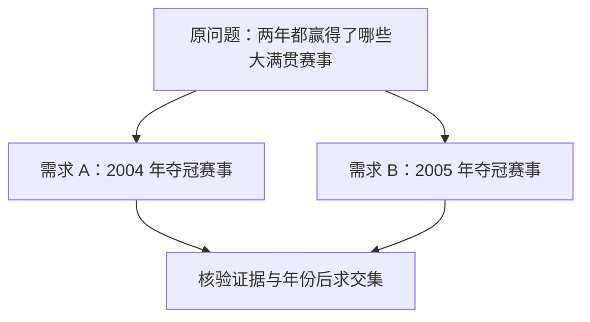

# DynamicEdgeGraph：训练什么、怎样利用 Edge，以及如何验证迁移

日期：2026-11-12。本文是 P0/P1 后的研究建议；仅核对已有文件、做只读统计并编写 Markdown，没有训练模型、修改代码或覆盖实验输出。

## 1. 建议先训练什么（根据后续讨论更新）

**当前核心假设是：通过已检索到的 seed 和 Edge，补回原始 query 直接检索排名较低的必要证据。先分别检验“候选发现”和“候选选择”：前者比较图扩展与同预算 Dense/迭代检索，后者在共同候选中比较直接 attention 与显式 Edge 表示。query / golden answer 可用于任务监督；不预设高维 Edge 或 clustering 必须存在。详见第 13–14 节。**

如果开展显式 Edge 的对照分支，再训练两个相连的模块：

1. **有向 Edge encoder**：从冻结的 source/target 表示生成连续向量，学习哪些端点信息和交互值得保留。
2. **状态条件化的 utility selector**：读取 query、已有证据集合 S、候选内容及 Edge 上下文，学习选哪一页，以及何时 KEEP_DENSE。

第一轮冻结 node encoders 和已有 Stage 1 工作点；训练共享任务定义下的交互/选择模块，暂不叠加 prototype、复杂 edge-to-edge attention 或新的候选生成器。无显式 Edge 对照应获得相同节点内容和多视图输入，允许 node–node 交互。训练可从已有答案监督开始；本文的 page/requirement/route 标签用于辅助定位与增强证据监督，并非开始任何训练前必须全部补齐。

“两个节点在某种 query 下可能有联系”是合理的建模动机，但监督目标需要进一步具体化：**对于当前 query 和当前证据，沿这条联系能够补充什么必要信息？** 仅预测两个节点是否相似、是否出现在同一文档、是否属于同一个簇，不能回答这个问题。

迁移方面：可以把同一套 Edge encoder 和 selector 应用于新语料，但目前没有证据保证有效。应迁移的是共享的关系/增量选择规则，而不是当前图的 node ID、某条边的可训练查表向量，或当前文档簇的编号。

## 2. P1 对训练方向提供了什么证据

核查来源：[P1 结果](stage2_edge_construction/outputs/edge_utility_slot_v1_20261112_r2/RESULTS.md)、[逐 route 分数](stage2_edge_construction/outputs/edge_utility_slot_v1_20261112_r2/route_scores.jsonl)、[逐题动作](stage2_edge_construction/outputs/edge_utility_slot_v1_20261112_r2/decisions.jsonl)、冻结 baseline 的 queries/gold/scores，以及 [P1 实现](stage2_edge_construction/src/run_edge_utility_slot.py)。

### 2.1 当前页级候选已经有机会，代表内容与选择仍有问题

- Dense Top-10 已完整覆盖 19/24 题，另外 5 题各缺一个标注 Gold 页。
- 这 5 页均在 P1 可选集合中：4 页在 graph 代表候选中，1 页正是 KEEP_DENSE 对应的第 11 页。
- 事后用 Gold 从“图候选 + KEEP_DENSE”中选择，固定 11 页的 **页级 oracle RecallAll@11 可以达到 24/24**；Dense-next 实际为 20/24，所有图 arm 为 19/24。
- 这只说明页级选择空间存在上限；它没有证明代表 node 包含正确证据，也没有证明某条 edge 有语义价值，更不是可部署方法的成绩。

| 未完整 query | 当前诊断 | 对下一步的含义 |
|---|---|---|
| 开幕式，`45db14c0…` | 缺页就是 Dense 第 11 页；所有图 arm 将它换掉 | 需要学习保留有用 Dense 页，不能把“图动作更多”当进步 |
| Warrior Falls，`4a5f4ed0…` | Gold 页有候选，现有评分未选中；代表内容及标注对齐仍需核验 | 先确认模型实际看到了什么，不把页标签直接复制到边 |
| H₂ / H₀，`4ba09a15…` | Gold 候选在各图 arm 中排第 12，margin 均为负 | 候选排序和相对 Dense 的判断都需要改进 |
| Federer，`df2f051f…` | Gold 页在各图 arm 中均排第 1，但 margin 全负，最终 KEEP_DENSE | 说明“候选中排第一”和“值得替换 Dense”是两个问题；还存在代表内容问题 |
| 两项研究的入组条件，`eb28ec1d…` | Pair/QK 的 Gold margin 为正但排第 3，QKV 排第 2 | 单纯放宽拒绝阈值不能修复被其他候选超过的问题 |

**代表内容的具体问题：** Federer 缺页的代表为 `HY_009`，内容是脚伤和年终 Masters Cup；同页与问题相关的 Wimbledon / US Open 内容在其他节点。应结合 canonical ID、原文和证据定位审查，不把“Gold 页上的最高 q·node”自动认定为 Gold node。Warrior Falls 的旧 bbox 对齐与当前节点原文还存在疑点，本文不把它当作已确认的节点级正例。Federer 原文可核对 [冻结节点文件](../EvidenceNet/output/baselines/vldocir_no_edge_v1_20261011/nodes/batch_92/hybrid/e5ea0384-1aac-4a0d-a512-42f4c631a180/page_0002/evidence_nodes.jsonl)，其中 HY_002、HY_005、HY_009 分别在第 2、5、9 行；其他节点含相关内容不保证它们已经与当前 seed 构成合法 route。

所以当前优先级是：**保留必要内容 → 学习增量选择 → 在新样本上评估候选生成是否需要改变。** 尚无必要为了这 5 题先把 Stage 1 图做得更大。

### 2.2 当前 QKV 有动作变化，但没有可测收益

- Pair 与 QK 的 action、selected page 在 24/24 题上相同。
- QK → QKV 有 3 题 action 改变、4 题 selected page 改变。
- Target-only → Pair 有 14 题 selected page 改变。

因此应描述为“没有测出 utility 增益”，不能描述为“Pair/V 没有参与计算”。

现有构造满足近似浮点恒等式：

\[
f_{Pair}=\tfrac12+\tfrac12z,\qquad
\Delta_{Pair}=\tfrac12(z-z_d),\qquad
\Delta_{QK}=\tfrac12(e^z-e^{z_d}).
\]

每条 route 的两种 margin 符号一致。不同 source 的参考分数不同，跨 route 排序并非理论上恒等；当前决策相同是实测结果。继续改这类几何公式，不能自动创造缺失的关系监督。

## 3. 一个训练样本应该是什么

基本训练单位是一个决策状态，而不是一条脱离任务的边：

\[
x=(q,S,\{p,\mathcal R_p\}_{p\in C},d).
\]

- q：问题。
- S：已经取得的证据，来自冻结检索或预先定义的检索轨迹。
- C：同预算下可竞争的候选页面。
- \(\mathcal R_p\)：通向页面 p 的少量、去重的合法 source–target routes，以及它们的内容/provenance。
- d：当前 Dense 替代项，即 P1 的第 11 页。

输入 S 必须包含实际可读内容或其固定表示，不能只有“这些 page ID 已选中”。当前 P1 的 S 只影响候选排除与最终输出，并未作为内容输入 scorer；所以它还无法直接判断“这部分证据已经有了”。

概念上学习：

\[
\hat U_\theta(q,S,p;\mathcal R_p),\qquad
\widehat\Delta_\theta(p,d)=\hat U_\theta(q,S,p;\mathcal R_p)-\hat U_\theta(q,S,d;\mathcal R_d).
\]

所有候选与 Dense 替代页使用相同页面评分接口、相同内容预算和同一个 S。d 缺少合法 route 时显式标记 context 缺失，不能把不存在的静态边伪装成事实关系。P1 的“同 source 替换 target”可以继续作为受控诊断，但不应被解释为已经测得的因果 utility；完整选择器要直接比较实际可执行的两个页面动作。

最终在唯一页面候选间选择，并保留 KEEP_DENSE。阈值只用独立开发集确定；原零阈值只是启发式分数的比较点，没有校准含义。

## 4. 标签应该监督什么

### 4.1 第一层：已有 page gold 可以提供弱监督

训练划分内令 G(q) 为标注 Gold 页集合，P(S) 为当前证据状态对应的唯一页面 ID 集合，可以定义：

\[
y_{page}(q,S,p)=\frac{|G(q)\cap(P(S)\cup\{p\})|-|G(q)\cap P(S)|}{|G(q)|},
\]

\[
y_\Delta(q,S,p,d)=y_{page}(q,S,p)-y_{page}(q,S,d).
\]

这能监督“新增标注页面”和“是否比 Dense 更好”。P(S) 只表示页面已选中，不保证有限内容预算内已经读到 Gold 片段。训练阶段合法使用训练标签；评估阶段只在动作冻结后使用测试标签。

但需要保留三个限制：

1. **页正例不等于 route 正例。** p 命中 Gold 不能推出其代表 target、source 或两者关系正确。
2. **无新增页不等于无语义价值。** 19 个 page-complete query 在该代理指标下为零收益，不能据此标记所有边无效。
3. **未标注页不一定无用。** benchmark Gold 不一定枚举所有替代有效证据。对用于强语义训练的困难负例应额外审查；不确定样本保留 unknown。

只有 page 标签时，先把任务诚实地称为“增量页面重排”。若使用多 route 的页面包，可以做弱监督的页面级学习；页面包里具体哪条边正确仍然需要证据，不能由模型 attention 自动认证。

### 4.2 第二层：更适合 Edge 的标签是必要补充、冗余与条件冲突

对训练集中的候选进行盲审，审核者读取 q、S、候选 p 和 Dense 页 d，隐藏 arm、分数与模型建议。记录：

| 标签 | 含义 |
|---|---|
| `P_BETTER` | p 相比 d 增加更多回答所需支持 |
| `D_BETTER` | d 更有用，图替换会损失支持 |
| `TIE` | 两者增量相当，包括都冗余 |
| `UNKNOWN` | 内容、图表或条件不足以确定 |

同时保存 source/target 的确切支持片段、补充了哪个要求、是否存在年份/人群/单位等条件错配。类别和解释不替代引用证据。

例如，q 要比较研究 A 与 B 的入组标准，S 已有 A：B 的入组标准应该比 A 的另一段重复介绍更有增量。把 S 换为已含 A+B 时，同一候选 B 的增量应下降。这样才直接监督“取决于 query 和证据状态”的含义。

进一步想训练 source 的贡献，需要**固定 q、target，改变 source 或 S 后有明确标签变化**的样本。不能强制所有换 source 的例子都变负；有些任务 target 本身已足够，有些 source 本来可替换。若 source 内容已在 S 中，简单换 route 标签也不一定改变真实页面 utility。

### 4.3 第一版损失用候选间偏好即可

对同一 q、S 下已判定的较优动作 a+ 与较差动作 a−：

\[
\mathcal L_{pref}=\log(1+\exp[-(\hat U_\theta(a^+)-\hat U_\theta(a^-))]).
\]

Dense 页 d 必须参与比较；同时训练图候选之间的优先级。TIE 不强行排出语义优劣，可约束近零分差或单设平局判别；UNKNOWN 不进入确定偏好损失。实际动作在没有可信正增量时倾向 KEEP_DENSE。

损失按 query/状态分组加权，避免候选多的 query 或 degree 大的页贡献过多梯度。同一题产生的多个 S、改写和 route 都属于同一数据组。

第一版不需要 RL。若后续确实处理多步桥接，再考虑路径级回报与延迟增益；不能用“本次没有直接命中 Gold”永久否定多步中间节点，也不能把多步目标混进当前单槽评价。

## 5. 模型具体训练哪些参数

显式 Edge 对照分支的最小版本可采用原任务书允许的小型非线性模块；是否需要它应与第 13 节的联合 attention 基线比较：

\[
e_{s\to t}=F_\phi([h_s;h_t;h_t-h_s;h_s\odot h_t]),
\]

\[
a_{s,t}=g_\psi(q,\operatorname{Enc}(S),e_{s\to t},h_t),
\qquad \hat U(p)=U_{base}(q,S,T_p)+H_\psi(q,S,T_p,\operatorname{PagePool}(\{a_{s,t},e_{s\to t}\}_{(s,t)\in\mathcal R_p})).
\]

这里 T_p 是同预算选取的页面内容表示，所有页面（包括 Dense 参考页）都具有共享的 state-target 基础分 U_base。H 是可正可负的学习修正，空 route 时定义 H=0，退回基础评分；不能将无 route 的 d 设为零分，也不能固定给有边页面正奖励。Edge 通道关闭时应恢复相同的基础评分路径。

- 冻结 h 与原始 node encoder；训练小型投影/MLP、状态交互和页面选择头。由页面偏好损失向 F 与 g 传递梯度。
- Edge 保持向量；最后的 utility 标量用于决策，不替代 Edge 状态。
- 第一版先用一个已验证兼容的向量视图。多视图时分别投影并保留缺失 mask，不直接混加不同 encoder 的原始坐标。
- 对每页保留少量不同证据片段和 source，控制读取/评分预算；先做 1 route 与一个小的固定上限的对照，不在 Pilot 上遍历参数。
- 去重后在页面内部池化，每页只产生一次最终竞争分；不要把跨所有 edge 的 softmax mass 求和到页。max/mean/attention pooling 也不自动消除切块、极值或候选组成偏置，仍需固定采样规则并做重复/切块审计。
- 固定向量若没有编码年份、表格单元格或条件，MLP 无法保证恢复这些信息。可用原文/视觉内容做独立教师审核，诊断“内容能判、向量难判”；此时先改善派生内容表示或使用读取这些内容的评分器，保留原冻结向量不变。

**不建议第一轮直接训练 WQ/WK/WV 的理由是缺少已验证的学习目标与输入，而不是 attention 不能训练。** 上述选择任务成立以后，QKV 可以作为 F、状态编码或 PagePool 的一种实现；它必须与较简单的网络使用同一监督比较。

Clustering 暂时可用于采样多样性、审查分组或控制计算量。不要把 cluster ID 当成真实关系标签；只有增加 prototype 后带来独立质量或成本收益，才继续研究它。

## 6. 必须训练哪些对照，才能证明利用了 Edge

| 对照 | 输入/能力 | 要排除的解释 |
|---|---|---|
| Dense-next | 原冻结策略 | 是否真正优于同预算普通检索 |
| Learned target | q、候选内容 | 收益是否只是监督训练带来的相关性重排 |
| Learned state-target | q、S、同样的候选内容包；强对照允许节点间联合 attention | 收益是否来自读取已有证据和减少冗余 |
| Learned edge | 上一项 + 有向 route/Edge 表示 | Edge 联合建模是否增加价值 |
| Edge + prototype/QKV，后续再做 | 相同输入与预算，增加该模块 | 复杂模块是否值得增加成本 |

所有学习模型尽量匹配模型容量、训练/优化预算、页面与内容预算、候选、开发集和阈值政策。source 已在 S 中时，不应把“重复多读了一份文本”算作 Edge 独立贡献。

**训练后的 Edge 模型只优于未训练 cosine，并不能证明关系学习有效。** 应重点看 Learned edge 相对 Learned state-target 的配对增益。

再做必要机制检查：相同内容下隐藏 edge 连接；在确实存在 source 依赖的样本中替换 source；改变 S 的已覆盖内容；精确复制同一 canonical edge。关系机制是否成立看受控任务的正确选择变化，不只看 logit 或 attention 是否变化。

## 7. 在“这个数据集”上训练的边界

### 7.1 24-query Pilot 不能承担迁移证明

3,311 个页面候选、13,244 条不同 arm 的分数记录和 950,871 个候选 pair，都不是同等数量的独立监督任务。当前只有 24 个反复开发的问题、5 个 Top-10 未完整状态；在上面直接拟合很容易记住文档主题或学会一律 KEEP_DENSE。

这 24 题保留为开发诊断。既有 Custom 111/125-query 结果已经被查看，也不能不经说明重新包装为从未接触的盲测集。可做分组分析或探索性训练，但结论必须与新独立评估分开。

### 7.2 VL-DocIR 没有现成的独立 benchmark 训练划分

官方 README 明确说明：Hugging Face 中名为 `train` 的 split 代表发布集合，不是一个单独定义的 benchmark 训练分区。因此需要自行冻结文档/问题族级划分，并标明这是自定义监督实验；不能默认在 `train` 上拟合后仍与原全量 benchmark 的未训练设置直接可比。[官方数据说明](https://github.com/yufanchen96/VL-DocIR/blob/main/README.md#dataset-access)

公开 RepresentativeSubset 的说明为 120 个 query；它与当前 24-query Pilot、Custom 111-query 集合不是同一评估集，也不是大规模监督数据来源。[RepresentativeSubset 数据卡](https://huggingface.co/datasets/anonymous-8421/VL-DocIR-RepresentativeSubset)

建议从尚未用于开发的完整数据中建立训练、开发、测试文档分区，先固定其 query/provenance 清单，再生成候选与训练样本：

- 同文档、同一来源文档的不同版本、近重复页面、相同问题的改写与同源合成问句放在同组。
- 跨文档 query 涉及的所有证据文档必须处于同一分区；可按证据文档连通分量分组，过大分量需明确处理，不能悄悄拆散。
- 严格未见文档实验中，训练 S、source、target、Dense reference 和困难负例都从训练分区索引获取，避免测试文档作为负例或上下文进入训练。
- Gold/答案/证据定位可用于训练标签或教师判断，不能作为部署时缺失的输入特征；尤其不能把 Gold 推出的“缺失证据说明”作为线上 query 状态。
- 混合真实检索失败、可成功补全、重复证据、条件冲突和已经充分的状态。训练可重采样稀少正例，阈值校准与测试恢复自然分布。
- 不规定一个未经学习曲线验证的“足够样本量”。先按独立 query、文档族、关系场景统计规模，并随新增独立组观察学习曲线；大量同题 route 不能替代独立任务。

若暂时无法形成足够的新数据，就把监督模型定位为小规模可行性探针，不宣称通用关系模型。

## 8. 如何更好生成 Edge

### 8.1 当前先改善一页内的证据保留

P1 页级 oracle 已有上限，立即扩大 Stage 1 可能只增加噪声。先审查每个候选页的代表 target 是否保留所需原文、表格行列、图注或约束；通过有限的多个独立片段减少单一最高 cosine 节点的损失。所有对照共享这一改进，单独记录它贡献了多少。

对有 page/element/bbox 标签的训练页，先核验源数据与 canonical node 对齐；对应不清或语义矛盾时标记 UNKNOWN。不要把 Gold 页所有 node、所有 incoming edges 都作为正例。

### 8.2 新数据出现候选缺口后，再改候选路线

可以在保持 query-independent Stage 1 的前提下，增加有来源的互补候选：

- 实体及属性匹配，同时保留年份、人群、单位、实验条件等约束。
- 表格行列、正文—图注、定义—使用位置等结构联系；结构来源独立记录，不自动认证为语义关系。
- 同一比较维度的不同对象、方法—结果等潜在互补片段；由内容审核决定是否能组合。

这些是待验证的候选生成规则。先在训练/开发文档比较：相同候选预算下，有用证据/合法 route 的召回是否提高；新图不能只用更大的候选数赢旧图。

若再训练生成模块，目标应是“在固定预算下召回经过核验的有用 source–target 组合”，可把已验证 selector/教师的偏好蒸馏给便宜的候选 ranker。训练负例包含同主题但错误条件、重复信息和被审核为不支持的组合；未被旧图召回的 pair 不能自动作为永久负例。

在线用 q 和缺失需求提出补充候选，也可以另做实验，但它属于新增的 query-conditioned 路由，不应悄悄替换已冻结的离线 Stage 1。需要与同预算 query-conditioned Dense 检索对照。

## 9. 训练结果能否迁移，以及如何证明

**可以部署到新数据集，不等于已经证明能保持收益。** 新领域的术语、图表、切块、候选分布及 Dense 强弱都可能改变选择难度和拒绝阈值。

| 实验 | 保持冻结/允许变化 | 可以支持的结论 |
|---|---|---|
| 同分布、未见文档族 | 模型与阈值冻结，重建该分区索引 | 文档级泛化 |
| 留出来源或领域 | 例如从若干来源训练，整个来源留出；共同预处理 | 来源/领域迁移，仍非跨 benchmark 的充分证明 |
| 独立数据集零样本 | 权重、阈值、预处理和候选政策冻结；按同协议编码和建图 | 严格的目标集零样本选择能力 |
| 目标域无标签适配 | 重估归一化、重新拟合 prototype 或伪标签训练 | 单独报告为无标签适配 |
| 少量目标域监督 | 用目标训练/开发标签微调或调阈值 | 少样本适配；目标测试仍需独立 |

普通建索引不等于训练；在目标语料上重新学习 prototype 或选择阈值属于额外适配，必须单列。换 node encoder 后即使向量维度相同，坐标语义也不保证兼容；应固定同一 encoder，或将对齐/重训列为新条件。

促进可迁移性的具体约束：

1. 参数共享地读取内容与相对结构；canonical ID 只用于连接和追踪，不作为可记忆的类别特征。
2. 训练覆盖多来源、多个关系场景和不同检索状态；不要只训练近邻/同文档例子。
3. 在训练数据内变换 query 和已覆盖的证据，建立同一 pair 在不同任务下有用/冗余的对照。语义改变需要重新审核标签。
4. 正式测试前冻结全部选择；同一外部测试集反复调参后只能作为开发集，另找未接触测试。
5. 首先报告目标集的候选页面召回、代表内容覆盖及 oracle 空间，再报告选择效果，区分建图迁移与 scorer 迁移。

外部基准需要与主张匹配：BEIR 可以补充一般检索的跨领域评估，但大部分常规相关性标签不能直接证明 Edge 的增量证据作用；MuSiQue 的连接式多跳设计可用于文本关系/桥接检查，不能据此声称视觉长文档能力已迁移。这些是实验选择建议，不是当前模型已经具备的能力。[BEIR 原论文](https://arxiv.org/abs/2104.08663)；[MuSiQue 原论文](https://aclanthology.org/2022.tacl-1.31/)

如果采用目标域造题与教师伪标签，GPL 提供了检索领域适配的先例，但这只能支持采用该训练思路；它没有替本项目证明关系标签可靠或零样本迁移有效。[GPL 原论文](https://aclanthology.org/2022.naacl-main.168/)

## 10. 下一轮的具体顺序与判定

| 顺序 | 交付物 | 决定什么 |
|---|---|---|
| A | `REPRESENTATIVE_CONTENT_AUDIT.md`：5 个失败机会及所有模型动作分歧的盲审；记录内容、Gold 对齐和 unknown | 先修内容保留还是可以开始学选择 |
| B | `TRAIN_DEV_TEST_SPLIT.md`：来源、文档族、query 族、开发历史、候选索引边界 | 训练和迁移结论是否有独立评估基础 |
| C | `UTILITY_LABEL_SPEC.md`：page 弱标签、偏好、tie/unknown、关系依据及审核方式 | 监督是否真的对应增量用途 |
| D | 同输入预算训练 state-target 与 edge 小模型；按文档组报告学习曲线 | Edge 是否比一般状态重排增加价值 |
| E | 冻结模型在未见来源和独立数据集评估 | 是否迁移；失败来自候选、表示还是排序 |
| F | 仅在对应瓶颈有证据后加入生成器、prototype 或 QKV | 增加模块是否改善效果或成本 |

至少报告：同预算 RecallAll/Recall、Gold gain/loss、证据要求覆盖（有可靠标签时）、KEEP_DENSE、每题读取/评分成本，以及 Learned edge − Learned state-target 的配对差值。按文档/问题族处理统计相关性；不要把 route 行当独立样本计算显著性。未建立 requirement 标签时报告 N/A，不以 page 命中冒充答案充分。

若 state-target 提升而 edge 没有额外提升，接受“状态感知重排有效，Edge 价值尚未证明”的结论；若教师看原文能判而向量模型不能，优先改善表示；若独立数据上候选 oracle 已低，才优先研究生成器。无需要求当前零训练 Pair 先成功才允许做监督实验，但监督实验必须有独立标签、对照与测试。

## 11. 补充：训练 Edge、训练路径、Transformer 与 RL 的关系

### 11.1 模型结构、输出形式和训练方法是不同问题

**如果系统要沿图逐步获取证据，输出确实可以是一段检索轨迹；学习的是跨问题共享的选择规则。Transformer 可以实现这条规则，监督学习或 RL 可以训练它。**

| 层面 | 解决的问题 | 在本项目中的选项 |
|---|---|---|
| 输出/任务 | 最终选出什么 | 一个补充页、多个证据动作、路径或证据子图 |
| 模型结构 | 怎样根据输入计算分数 | MLP、Transformer、带 Edge 的状态交互模块 |
| 训练方法 | 根据什么信号更新参数 | 正确动作标签、偏好、路径示范、任务回报 |
| 推理搜索 | 模型训练好后怎样找结果 | 一次排序、逐步贪心、有限 beam search |

因此，“输出是一条路径”并不规定用 RL；beam search 也只是搜索方式，不能据此判断训练算法。反过来，一个 Transformer 同时可以用监督损失训练，也可以充当 RL 的策略网络。

应区分三种容易混称为“路径”的东西：

1. **候选 route**：当前 P1 的 source→target，用来描述页面候选来自哪里。
2. **图内信息传播**：Stage 2 中相邻 Edge 互相 attention、更新表示；经过多层可融合多跳邻域信息，但不等于执行了一串检索动作。
3. **实际检索轨迹**：选一个动作、读取新证据、更新状态，再决定下一步；这种过程才显式涉及序列决策。

原设计的 local edge-to-edge QKV 属于第二种，可以通过下游监督损失反向传播训练。attention 权重也不能单独当作已验证的推理路径。

### 11.2 目前 P1 训练的是什么

P1 固定已有证据 S，只决定额外一个页面槽位：

\[
(q,S)\longrightarrow\{p_1,p_2,\ldots,p_m,d\}\longrightarrow\text{选一个页面}.
\]

如果训练样本能告诉模型“候选 p 比 d 更有用”，就可以用前述排序/偏好损失训练。这里没有必须经历的中间状态，也没有必须等待多步之后才能得到的回报，所以第一版没有采用 RL 的必要。

可以将评分模型写成下一动作分布：

\[
\pi_\theta(a\mid q,S)=\operatorname{softmax}_{a\in\mathcal A}z_\theta(q,S,a),
\]

其中动作对应去重后的候选页面及 KEEP_DENSE。已知正确动作 a* 时，普通监督损失为 \(-\log\pi_\theta(a^*\mid q,S)\)。存在多个合理动作时用偏好或多正例监督，不任意选一个当唯一真值。这个 softmax 用于唯一动作之间的竞争，不把大量同页 Edge 的概率累加成页面优势。

一个使用 Transformer 的实现可以把 query、已有证据和候选 Edge 表示作为输入，输出各候选 logit；交叉熵/偏好损失对 logit、Transformer 和 Edge encoder 反向传播。训练时不需要对最终硬 argmax 求导。

这里称为“策略/选择规则”只是描述模型功能，并不表示已经在做强化学习。也存在单步 bandit/RL 设置；只是当前可以直接比较已知候选的监督任务不需要先引入它。

### 11.3 以后做多跳时，学习对象仍可保持统一

未来状态应包含 query、实际已读证据、可扩展节点以及剩余预算：

\[
x_t=(q,S_t,F_t,b_t),\qquad a_t\sim\pi_\theta(\cdot\mid x_t).
\]

取到新证据后更新 S、候选 frontier F 和预算，再调用同一模型。得到的轨迹为 \(\tau=(a_1,\ldots,a_T)\)。参数是跨所有状态共享的，不给每一条固定 node-ID 路径训练独立参数。

**有可信示范时，多跳也可以监督训练：**

\[
\mathcal L_{path}=-\sum_t\log\pi_\theta(a_t^*\mid x_t^*).
\]

可以类比 Transformer 的 next-token 训练：文本是一段序列，也可以通过监督下一个 token 学出来；检索时则根据当前状态预测下一个合法证据动作。候选节点通常是动态集合，应按候选内容打分，不把当前数据集的 node ID 当固定词表记忆。

训练时提供示范前缀和下一动作，推理时使用模型自己的选择。需要另测前面选错后能否恢复；只在正确前缀上训练，并不保证实际 rollout 稳定。Asai 等人的图检索工作就是通过监督每步的证据选择来学习推理路径，说明路径检索并不必然采用 RL。[原论文 §3.1.2](https://arxiv.org/html/1911.10470#S3.SS1.SSS2)

**只有终点/证据集合时，也不只有 RL 一种办法：** 对有限候选路径做完整路径偏好学习，或者将合法路径视为潜变量、对多条可接受路径的概率做边缘化，都可以作为弱监督方案。它们仍需要可靠的路径接受准则和受限搜索，不能把“偶然到达 Gold 页”当作语义正确路径。

注意：VL-DocIR 的 Gold evidence 是集合，通常不提供唯一访问顺序。页面 A、B 都是 Gold，既不说明一定先 A 后 B，也不证明存在有用的 A→B 关系。不能将 Gold 页按 ID 或页码排序后当路径示范。

### 11.4 什么情况下 RL 更值得考虑

设一个示意任务要求找到“论文 P 第一作者所在机构的城市”。已读页面只给出作者，下一节点 B 提供机构，之后节点 C 才提供城市。B 当下不直接给最终答案，但对发现 C 有帮助。

如果训练数据只告诉我们完整检索后是否找到了可靠答案，而无法给出每一步应该选什么，学习就需要处理：**最后的成功应该给前面哪些动作记功？** 这是 RL 可处理的信用分配问题。可以定义期望回报目标：

\[
\max_\theta\;\mathbb E_{\tau\sim\pi_\theta}
[U(q,S_T)-\lambda\,\mathrm{Cost}(\tau)].
\]

U 应反映经过核验的证据支持/任务质量，Cost 反映真实读取或计算代价。具体奖励、预算约束和权重需要独立训练/开发设计；本文没有执行这项训练。

MINERVA 是用 RL 学习 query 条件下图遍历的实例，但它处理的知识库节点和关系，与本项目的文档证据及未验证候选边存在差别，不能直接照搬其奖励。[MINERVA 原论文](https://arxiv.org/abs/1711.05851)

这时仍可使用 Transformer 计算策略：**Transformer + RL** 是兼容组合。也可先用示范监督初始化，再用任务回报优化。现有零训练 QKV 中的 V 是 attention 的 value 表示，与 RL 中估计未来回报的 value function 不是同一个概念。

如果只有终点命中回报，错误或偶然的路径也可能得到奖励；相关 KG 路径研究明确讨论了这种伪路径与不完整标注的问题。因此不能期待 RL 自动解决当前代表内容遗漏或 Gold 对齐问题。[Multi-Hop Knowledge Graph Reasoning with Reward Shaping](https://aclanthology.org/D18-1362/)

也要区分两种目标：当前单槽的即时增量，以及多步桥接的长期收益。前者训练好不保证后者；用“当前不命中 Gold 就永远为负”的标签训练多跳策略，会压制有用中间节点。

### 11.5 对 DynamicEdgeGraph 的具体定位

你们有多个 seed，比较、汇总任务也可能需要从不同 seed 分别补充证据。最终更自然的输出可能是证据集合或有分支的子图，而不一定是一条必须连续的链。建议把动作定义为“从当前 frontier 获取哪项新证据”，保留必要的来源；只有任务本身需要依赖链时，再要求相应连接顺序。

当前推进顺序仍是：

1. 修正单代表内容遗漏，用可靠标签训练一次补充选择；验证 Edge 相对同样训练的 state-target 的贡献。
2. 在新数据上建立受控的两步任务，包含确实需要中间节点的案例；更新实际 S，并与相同总预算的 Dense 扩展比较。
3. 有可信路径示范时先做逐步监督；缺少路径示范但存在可靠终局回报、且确实有延迟收益时，再比较弱监督路径学习与 RL。

KEEP_DENSE 是使用本次 Dense 替代项，STOP 是结束检索，两者的预算和后果不同。P1 没有测试真正 STOP；未来多步实验必须明确区分。

单步选择失败不能证明所有多跳方案无效；它说明当前内容与即时选择仍未建立可靠基础。引入多跳应增加一个明确的新研究问题，而不是仅靠换成 RL 解释现有失败。

## 12. 补充：一个问题需要回答多个子问题时怎么办

### 12.1 把尚未满足的证据需求显式放进状态

**对于复合问题，选择器应知道原问题需要哪些信息、哪些已经得到支持、哪些还缺，以及哪些子问题依赖前面的答案。** 这使得此前的 S 从“已经选了哪些页”进一步变成可用于判断进度的证据状态。

前面的 P1 只诊断固定 S 下的一次补充选择，不能单独验证完整的多子问题求解。它仍然有用，但不足以定义最终系统。反过来，多子问题也不必然要求多跳：一页可能同时回答几个子问题；已有 Top-10 也可能已经覆盖大部分要求。

可以把在线状态写成：

\[
x_t=(q,\mathcal R_t,\mathcal D_t,S_t,F_t,b_t),
\]

其中 R 是证据需求/子问题，D 是它们的依赖，S 是已有证据，F 是可扩展候选，b 是剩余预算。R 与 D 是根据原问题及已读内容形成的可修正计划，不能来自测试 Gold 或答案。

不要求每个需求都生成一段很长的自然语言子问题；短的、保留实体与约束的信息槽也可以。初期显式文本更方便审查，是否改为潜在表示以后再验证。

### 12.2 至少区分并行需求和依赖需求

**并行需求：** 例如现有 Federer 问题可以考虑分别确定 2004、2005 年的大满贯冠军赛事，再核对两年共有的赛事。

这两项可并行检索；先取得哪一项不应被当成唯一正确顺序。若同一段原文已经明确支持两年连续夺冠，它也可能同时满足两个需求；无需强制找两份材料。对于“哪些”这类集合问题，还要检查证据是否足以支持完整枚举，不能把找到一个例子等同于已回答全部。

**依赖需求：** “论文 P 第一作者所在机构在哪座城市？”需要先识别作者，再据此确定机构，最后确定城市。后续子问题可以暂存变量，等上一步有来源的答案后再实例化；不能提前猜测作者或机构并当作已知事实。

两种情况可以混合为依赖 DAG。图可以随阅读更新；部分依赖尚不明确时保留未绑定变量，而不是强行一次性生成完整路径。问题分解并接入检索已有 Self-Ask 等研究先例；依赖式多跳可参考 MuSiQue 的连接式问题构造，但本项目仍需要单独验证分解与检索是否有效。[Self-Ask](https://aclanthology.org/2023.findings-emnlp.378/)；[MuSiQue](https://aclanthology.org/2022.tacl-1.31/)

### 12.3 一个子问题与一个证据节点不是一一对应

每项需求建议记录：

| 字段 | 作用 |
|---|---|
| 子问题/要求及实体、年份、单位、条件 | 防止拆分后丢失原问题约束 |
| 前置需求与未绑定变量 | 决定何时可以执行 |
| `missing / partial / supported / conflicted` | 区分没有证据、部分支持、已支持与冲突 |
| 支持的原文 span、表格单元格或视觉区域 | 让“已完成”可以核验 |
| 尚缺内容 | 指导下一次选择；只基于在线可读内容形成 |

一个需求可能需要多个节点共同支持；一个节点也可能支持多个需求。比较任务还要检查两边的指标、单位与适用条件是否可比较。LLM 声称“已回答”不等于有充分证据，bbox 重合和页面命中也不能单独完成这个判定。

多个必要需求之间是 AND：原问题需要它们都得到支持，再完成比较、求交集、计算或其他组合操作。某项需求内部可以存在多套替代证据，即 OR；其中一套证据还可能需要多个片段共同成立。第一版可通过状态表和集合级核验表达这些关系，不必立即增加新的图架构。

即使每个子问题都回答对，也仍需检查组合步骤是否回答了原问题。Self-Ask 论文专门研究了子问题正确、整体组合仍出错的现象，因此最终核验不能只统计子问题命中数。[原论文](https://aclanthology.org/2023.findings-emnlp.378/)

### 12.4 Edge 应当帮助哪个需求，以及怎样接入当前项目

将在线选择从“这条边与整个 q 有多像”细化为：

\[
\operatorname{score}_\theta(r_i,e\mid q,\mathcal R_t,\mathcal D_t,S_t).
\]

它需要区分：这条 route 对应哪项未满足需求，是否重复已有内容，是否提供下一步所需的桥接事实，以及条件是否匹配。这里的 score 可以是监督学习的选择分数，不应未经校准就称为真实概率或长期价值。

如果采用 attention，可以让不同需求各有一个 query 表示，对候选 Edge 的 key/value 读取内容；随后由共享的选择模块分配总预算，并由证据核验更新状态。**增加 attention heads 不会自动得到正确子问题分解。** 也不要把每个需求、每条边的 attention mass 全部求和回页面，否则容易重新引入重复与数量优势。

需要同时保留两张不同含义的图：

- 离线证据图：节点是文档内容，边是 Stage 1 候选及其派生表示。
- 在线问题依赖图：节点是当前任务的需求，边表示某个答案是另一个子问题的前提。

它们通过证据支持关系连接，不能把“两个子问题有依赖”直接当作某对文档节点之间的已验证语义边。

原 Stage 1 仍可以与 query 无关。子问题影响的是在线 seed、候选评分与扩展决策；若允许额外 Dense 子问题检索补充静态图缺口，需单独记录来源并纳入相同预算，不能悄悄写回冻结图。

### 12.5 怎样训练，不必先把所有组件一起训练

第一版可固定或人工审核一小批分解，优先训练“在这些需求下下一步取什么证据”。这样能把分解质量和 Edge 选择能力分开测量。

训练样本扩展为 `(原问题, 当前需求及依赖, 已有证据, 候选动作, 剩余预算)`。可用三类监督：

1. **支持/覆盖监督**：哪些片段支持哪项需求，是部分还是完整，是否存在条件冲突。这个标签需要在训练分区建立，不能从 Gold 页集合直接推导完整分解。
2. **下一步偏好或多正例监督**：哪些候选比其他候选更值得读取。两个独立需求都未满足时，补 A 或补 B 可能都是合理动作，不强迫唯一顺序。
3. **完整集合/轨迹监督**：最终证据是否同时满足所有必要要求，是否能够正确组合为答案。用于防止只反复覆盖容易的一个需求，也用于给有价值的中间桥接步骤提供监督。

这些目标可以使用普通可微损失训练 Transformer/Edge encoder。对存在延迟收益的任务，需要经过核验的桥接示范、路径/集合级偏好或回报；逐步 Gold 页命中不能作为唯一目标。只有主要依赖终局回报时，再考虑第 11 节讨论的 RL 等方案。

子问题分解器可以先固定，selector 先训练，完成核验也可先用独立审核流程。若三者同时改变，即使有收益也难以定位来源。分解后用普通 Dense 检索本身就可能改善结果，所以必须为无 Edge 对照提供相同分解。

### 12.6 下一步的小实验应怎样设计

建议在独立的新 query/文档上建立一个有限诊断：2–3 项证据需求、最多两轮扩展，覆盖并行比较与确实需要中间节点的依赖任务。这个规模是便于审查的实验设置，不是推荐的最终系统上限。

比较三组：

- 原 query 的同预算 Dense 扩展。
- 相同子问题/状态下的 Dense 扩展或 learned state-target。
- 相同子问题/状态、内容与总预算下的 Edge 扩展。

全局预算共享，同一页重复发现只计一次实际新增读取；不能每个子问题各拿完整预算再与单 query 基线比较。若一页帮助多项不同需求，可以记录多项真实覆盖，但复制同一需求不应增加权重。

报告每项需求覆盖、所有必要需求共同完成率、组合后的答案及引用正确性、读取/评分成本。并分解失败来源：分解遗漏、缺候选、代表内容不足、选择错误、证据冲突、组合错误。需求完成指标需有独立标签；没有时报告 N/A。

Budget-matched D1 的旧结果已经提示子问题检索值得单独作为对照，但它使用旧节点预算/表示，不能与当前 P1 的页面数字直接混比，也不能证明 Edge 的独立收益。[旧报告](../EvidenceNet/output/budget_matched_dense_control_v1_20261106/BUDGET_MATCHED_REPORT.md)

停止有两种原因：必要证据充分且能组合回答，或预算耗尽/没有可行进展。后一种应记录未解决的需求；“停止检索”不能自动成为“已经回答完整”。

## 13. 补充与优先级修正：直接 Attention 是否已经足够

### 13.1 先承认显式 Edge 不是必需前提

**如果同样的节点内容已进入模型，而且 attention 网络能够联合处理这些节点，那么它可能不需要单独构造、存储和聚类 Edge 向量。现有结果没有证明显式 Edge 优于这种训练后的基线。**

前文建议“训练 Edge encoder”描述的是一个可以验证的分支，不是任务必须采用的结构。根据本轮讨论，优先建立直接 attention 基线，再测试 Edge 的独立贡献。

当前 [E0 实现](stage2_edge_construction/src/representations.py) 的 mid、diff、concat、interaction 都是节点表示的确定性变换：

\[
e_{ij}=F(h_i,h_j).
\]

在未分别归一化的 mid/diff 中甚至有：

\[
h_i=\mathrm{mid}-\tfrac12\mathrm{diff},\qquad
h_j=\mathrm{mid}+\tfrac12\mathrm{diff}.
\]

这是一种重新表示，不增加原节点向量之外的输入证据。归一化不会凭空补出缺失事实。有足够表达能力的联合网络原则上可在内部学习相似的 pair 功能；不能从信息等价进一步推出有限规模模型一定同样好训练、同样省计算，这仍需实验。

有 prototype、邻域或其他视图后，输入范围可能增加。比较时要检查增加的是哪些信息，并给基线相同信息访问条件；不能把额外读入其他节点或额外 encoder 视图的收益全部归于 Edge 这种表示形式。

### 13.2 “Attention”需要明确是哪一种

| 形式 | 能做什么 | 能否据此判定 Edge 多余 |
|---|---|---|
| 对独立冻结节点计算 q·h_j 再 softmax | query–target 匹配与归一化竞争 | 不充分，候选竞争本身没有显式计算 source–target 内容交互 |
| query/S 与候选内容联合建模，含节点间 self-attention 或等价的多层交互 | 可以隐式利用节点组合、依赖和已有证据状态 | 这是有说服力的无显式 Edge 基线 |
| 根据图邻域限制 attention | 使用候选图限制信息传播/计算 | 图作为连接约束仍在，但可以完全不存高维 Edge 向量 |
| attention 加独立 Edge 状态/特征 | 为每个 pair 提供可更新或可复用的表示 | 是否值得增加需单独消融 |

attention 权重可以视为一次计算中的有向连接强度，但它不是自动确认的语义关系。高维 Edge 状态与标量 attention 权重不是同一对象；这也不证明额外 Edge 状态一定更有效，因为普通网络已有隐藏表示与多层交互。

GAT 使用邻域内的 masked attention，Graphormer 将结构信息引入 Transformer，说明图结构与 attention 可以结合；这些工作不证明当前 mid/diff 或 clustering 必须保留。[GAT](https://arxiv.org/abs/1710.10903)；[Graphormer](https://arxiv.org/abs/2106.05234)

### 13.3 Query + golden answer 可以直接定义任务监督

若已有训练问题 q、答案 a* 和合法候选内容 C，可以训练：

\[
\mathcal L_{ans}=-\log P_\theta(a^*\mid q,C).
\]

对于生成式 reader，这是答案 token 的条件交叉熵；其他输出形式使用对应损失。答案是训练目标，不能把完整答案提前放入检索输入；自回归 teacher forcing 的已生成答案前缀属于正常训练条件。

可以先固定候选检索，让 attention 与 reader 学习如何使用候选。原 node encoder 可继续冻结，训练交互/适配/输出模块；具体哪些 reader 参数可训练需按统一实验协议指定。检索增强模型使用任务输出监督的思路已有先例，不要求预先提供每条 Edge 的人工关系标签。[RAG 原论文](https://arxiv.org/abs/2005.11401)

但答案监督只约束最终输出，并不唯一约束内部关系：模型可能依靠参数记忆、单个 target、不同的合法证据组合，或者绕过 Edge 分支。**正确答案不能单独证明某条 Edge 被正确学到、被使用，或对答案不可替代。**

因此，之前提出的证据/偏好标签并非“没有就不能训练”，而是用于更直接地监督证据使用、诊断关系贡献。当前已有 page gold 也可作为辅助目标，不应将其自动变成 node-pair 关系真值。24-query Pilot 的独立样本不足与已被反复开发的问题仍然存在。

另外，普通反向传播需要实际可微计算链。若 attention 只用于硬 top-k 选页，再把页面发给不可反向传播的外部 reader，答案损失不会自动训练上游 selector；可先用候选偏好蒸馏、有限潜在候选的边缘化等方法建立训练链，再考虑 RL。不能因为写出了上述损失，就认为任意检索实现都可端到端求导。

### 13.4 Edge 值得保留的三种可检验理由

1. **路由与计算收益。** 候选图让模型在固定预算内找到有用上下文，或减少需要处理的交互。需要与“先检索有界候选，再直接 attention”、其他稀疏机制比较。仅 query 对 N 个节点打分约是线性规模；M 个候选节点完整 self-attention 的交互部分约为 M²，不能把所有无 Edge 方法都描述成全库 N²。还需计算离线建图、Edge 向量存储、更新与在线成本。
2. **额外关系信息。** 引用链接、表格行列、时间或来源等信息可能未保存在现有节点向量中。需给无 Edge 模型同样信息，区分“信息本身有帮助”和“必须用 Edge 存储才有帮助”。
3. **共享 pair 状态带来的归纳偏置或复用。** 有向关系表示可能在较少训练数据、重复查询或固定计算预算下更有效，但也可能带来存储与维护负担。用学习曲线和质量—成本对照验证，不能只依据表示是向量就断言更强。

聚类中心如果只来自同一批节点/边的几何变换，也不自动增加事实证据。它可以作为压缩或计算分组方案，但其质量和成本收益同样需要证明。

### 13.5 把下一轮比较改为真正能回答“需不需要 Edge”的实验

先固定同一候选内容池、query/答案、S、子问题政策、reader、训练/开发划分与可读内容预算：

| Arm | 结构 | 要检验什么 |
|---|---|---|
| A：直接联合 attention | q/S 与节点内容交互，不额外保存 Edge 向量 | 强无显式 Edge 基线 |
| B：图限制的 attention | 相同内容，按候选图限制交互，不加 Edge 向量 | 图连接/稀疏约束的贡献 |
| C：B + 显式 Edge 表示 | 相同连接，加入可训练有向 pair 状态 | Edge 向量的独立贡献 |
| D：C + prototype，后续再做 | 其他设置相同 | clustering 是否值得增加 |

尽量匹配参数容量与优化预算，记录实际 FLOPs、延迟、显存及离线成本；质量与成本不能完全同时匹配时，应报告取舍，不能把更大模型的收益归于 Edge。

如果共同候选池由 Stage 1 提供，A 只是“无显式 Edge 向量/交互约束”的模型对照，整个 pipeline 仍用了图候选。另做端到端比较时，允许普通检索与图路由各自取候选，在相同总成本下评估，这才能判断 Stage 1 是否有用。

所有组使用相同答案监督；评估同时保留证据覆盖/引用支持。增加 query-only、去掉关键证据等诊断，检查答案是否依赖输入证据，但不把单个扰动后的分数变化当语义关系证明。测试仍按未见文档/问题族进行。

结果解释：

- C 稳定优于 B，才支持显式 Edge 表示在该任务和预算下有价值。
- B 与 C 相当、B 比 A 更省成本，则优先考虑保留稀疏路由，省去 Edge 向量/聚类；贡献定位为效率。
- A 在质量和成本上已相当或更好，就采用更简单的无显式 Edge 版本，并报告当前未证明 Edge 收益。
- A/B/C 都弱时，先定位候选召回、内容保留、数据量和 reader 能力；不能据此直接断言图或 attention 普遍无效。

本轮最重要的调整是：**用已有 query/answer 先学习任务，再通过对照决定是否需要显式 Edge。**

## 14. 核心目标澄清：通过 Edge 补回原始 Query 相似度较低的证据

### 14.1 这是候选发现假设，也需要后续正确选择

用户希望实现的机制可以写成：

\[
q\longrightarrow s\longrightarrow t,\qquad
\operatorname{rank}_{dense}(t\mid q)>B,
\]

其中 B 是初始检索预算，s 是先找到的 seed，t 是直接检索未纳入预算、但有助于回答问题的目标。通过 s→t 将 t 提交给后续 reader/attention，才有机会实际使用它。

这里的两项分数不同：原 query 与 target 的匹配，以及 seed 与 target 的候选联系。t 对原 query 排名低，不表示它与 s 也没有联系。因此，静态相似度图本身也可能补回低 query 分数的目标；不能直接断言 similarity pruning 一定把所有此类目标删掉了。

示意问题：“论文 P 的第一作者所在机构在哪座城市？”原 query 容易找到论文与作者信息；机构城市页面可能不包含论文名或作者名。先找到作者，再借助机构信息获得城市证据，是图路由可能发挥作用的场景。实际路由必须核验实体、版本与适用条件，不能由这个例子推断所有相似邻居都有效。

图检索研究也明确讨论过必要证据与原问题词面/语义匹配较弱的情况，并使用此前取得的证据继续检索。[Learning to Retrieve Reasoning Paths](https://arxiv.org/abs/1911.10470)

### 14.2 第 13 节的 attention 对照有一个适用边界

**仅在已经交给模型的候选集合中做 attention，无法读取未进入集合的目标原文。** 即使模型凭参数记忆回答正确，也不等于已经检索回该证据。

因此应分开测量：

\[
\text{语料}\xrightarrow{\text{路由/检索}}\text{候选内容}
\xrightarrow{\text{联合选择/阅读}}\text{最终证据与答案}.
\]

共同候选上的 attention vs Edge 比较，只隔离第二段的建模贡献。若先用图找到 t，再把 t 同时交给两组，结果相同并不能说明图路由没有作用。端到端实验还必须允许普通检索与图路由各自发现候选。

这也不意味着 attention 系统只能使用一次 Dense Top-K。query+seed 的迭代检索、子问题检索和其他有界候选机制，都可以将最初缺失的证据带进来；它们是图补召回必须比较的替代方案。

### 14.3 现有 P1 已有机会，但未完成有效补回

4 个图候选中的缺失 Gold 页，原 Dense 页排名分别为 17、40、12、13；第五个缺页是 rank11，由 KEEP_DENSE 表示。它们均能进入 P1 的可选页面集合，说明在这批诊断样本中，图可达性没有阻止这些缺页出现。

但当前所有图 arm 没有取得 Gold gain，反而丢失一个 Dense-next Gold 页。原因至少涉及代表内容和选择规则：Federer 的 Gold 候选排名第一但 margin 为负；代表 target 又没有保留关键大满贯内容。

还应限定三个解释：

- 原 Dense 页排名较低，只是直接检索困难的代理，不等同于已测得 target node 的绝对 query cosine 很低。
- 页级可达不保证经过的 source–target route 具有语义支持，也不保证代表 span 包含答案证据。
- 当前冻结 baseline 已对全部 518 页保存分数。这里的“捞回”指进入有限的最终检索/阅读预算，不是发现原语料之外的新页面。

### 14.4 Stage 1 与 Edge 生成应围绕这个目标检查

先检查两个问题：

1. 对原 query 漏掉的必要证据，是否至少有一个实际 seed 能通过合法候选 route 到达？
2. 若页面可达，实际用于选择的 target 内容是否保留所需证据？

只有这类页级/内容级机会确实缺失时，才优先增加候选生成能力。当前 Pilot 不需要为了已有 5 个页级机会直接扩大图。

若新数据表明 seed 与 target 本身也不相似，可增加有 provenance 的候选来源，例如实体/别名、引用、定义—使用、正文—表格/图注、同一对象的不同属性。结构连接先作为探索线索，不自动提升为已验证语义边。

不要在召回这些目标之后，又仅按原 q·target 进行激进剪枝，或要求其必须超过 Dense 下一页的原始相似度才能保留。应让选择器根据原问题、seed 内容、尚缺需求和目标内容判断用途，同时保留冗余与错误条件的负例。独立 query 相似度仍可作为特征，不应成为所有有效补充证据必须跨过的唯一门槛。

### 14.5 对应的训练目标是什么

训练的是条件化的下一证据选择，例如：

\[
P_\theta(t\mid q,S,s,\text{尚未满足的需求},\text{候选集合}).
\]

训练正例应包含直接 q→target 排名靠后、但借助已取得内容可以确认用途的必要证据；困难负例包含与 q 或 seed 很相似、却重复已有信息或实体/条件不符的内容。较高相似度本身不是负标签，较低相似度也不是正标签。

可使用训练分区的 page/evidence 标签建立候选级弱监督，用原文对齐确认代表内容；query+golden answer 支持答案目标，但答案正确本身不能认证具体 source→target 关系。只有在输入与可微训练链成立时，答案损失才能有效传到相应选择模块。

不要求每个低相似度正例都对应唯一 source，也不要求只有图方法能够找到它；应公平检验同样使用 seed 内容的无图检索。若需要中间桥接节点，则沿用第 11–12 节的路径/集合级监督，不把没有即时 Gold 页命中的桥接动作自动标成负例。

### 14.6 最小实验应分为“发现”与“使用”两组

**候选发现实验：** 从相同初始 seed 和证据状态出发，保持相同最终页面/内容预算，并报告在线计算与离线成本，比较：

| 方法 | 扩展方式 | 检验内容 |
|---|---|---|
| Dense-next | 继续取原 query 排名靠后的页面 | 普通增加预算能否解决 |
| Iterative Dense | 根据 q、已读 seed/证据或共享子问题继续检索 | 上下文条件化是否已足够 |
| Graph expansion | 从实际 seed 出发扩展有界邻居 | 保存的候选联系是否提高补召回 |

扩展轮数、seed、内容预算和候选核验规则应统一。节点/页面数不是完整计算预算，需同时报告新增 query 编码、候选评分数量、reader token/像素与延迟。图方法不可通过遍历更多邻居和读取更多页面无代价地取得优势。

**候选使用实验：** 固定上述方法发现的共同候选，给相同 reader/attention 输入相同内容；再比较不加 Edge 特征与加可训练 Edge 特征。它回答高维 Edge 表示是否有独立价值，不再承担证明路由贡献的任务。

至少报告候选池中的新增 Gold/必要 span、最终实际保留的新增证据、丢失证据、全题完整覆盖与答案支持。成功案例要能追踪：原 Dense rank → 实际 seed → route 来源 → source/target 原文 → 补充了哪个要求。

按预先冻结的 Dense 排名范围做后验分层，同时报告所有 query；保留没有合法 route、没有正确代表内容的失败，不能只挑图可达样本测试。Gold 只用于训练标签或冻结动作后的评价，不用于测试时选 seed、补边或调阈值。

**若 Graph 比 Iterative Dense 更能在相同预算下补回必要证据，就支持图路由的研究价值；即使后续不需要高维 Edge 向量或 clustering，这个贡献仍然成立。** 若二者相当，则应如实判断图是否在成本、稳定性或可复用性上另有优势。
