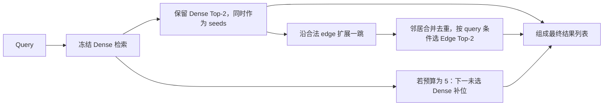

# DynamicEdgeGraph：仅做 Retrieval 的 Edge 排名架构

日期：2026-11-14。依据用户最新澄清修订。本文只提出设计，没有修改代码或运行实验。

> **最新扩展：用户进一步提出按 Dense/Edge 的预计收益动态分配剩余预算，并处理 seed→A→Gold 的多跳情况。当前完整目标见 [自适应预算与多跳检索方案](ADAPTIVE_BUDGET_MULTIHOP_RETRIEVAL_20261114.md)。本文件保留为一跳基础架构及固定配额对照；其中固定 2+2 和一跳限制不再是最终方法的硬约束。A/E 的检索信号定义继续沿用。**

> 用户随后提出保留部分原检索结果，例如 `Dense Top-2 + Edge Top-2`。当前优先方案据此改为第 3 节的**按来源预留名额检索**：先分别选择、再组成结果列表；第 4 节统一分数重排保留为后续可选方案，不作为起步前提。

> 用户进一步明确：Edge 分支需要超出 similarity 的信号，考虑 answerability 与 evidentiality。第 5.1–5.4 节将它们作为**检索阶段的预测/辅助监督信号**纳入；仅做 retrieval 不代表必须排除 A/E，也不要求在线生成完整答案。

## 1. 当前目标与交付边界

**输入 query，输出排好序的 Top-5 / Top-10 node 或 page。利用高排名 seed 与低排名相关目标之间的 edge，提升目标在最终结果中的排名。**

用户的典型例子：目标 v 是离线标注的相关节点，直接检索排第 40；直接检索 Top-1 的 u 与 v 有 edge。希望系统利用 u→v，使 v 进入最终 Top-5。

这里的 Gold 指检索对象的相关性标注，不是在线系统已知道的答案。推理阶段输出候选排名；可以估计局部 answerability 与潜在 evidentiality 来改善选择，不要求证明节点能生成正确答案。完整回答生成与生成后验证闭环不属于当前主流程。预测 A/E 与对真实答案进行严格支持验证需要区分。

上一份状态条件化 VQA 架构已经标为历史讨论。本修订保留两层表示、候选去重与度数偏置检查，但去掉回答闭环。用户旧 Node 数据集仍按既有任务书优先定位复用；整理阶段优先建立 query–相关 node/page 标签、原内容及图的对应关系，无需先完成完整 VQA 标注。

## 2. 两种作用必须区分

| 情况 | Edge 可以贡献什么 | 需要检查什么 |
|---|---|---|
| 原 rerank 候选只有 Dense Top-10，第 40 名不在里面 | 从 seed 扩展，将目标带进候选 | 扩展预算内是否真的进入候选，之后能否进 Top-5 |
| 原 rerank 候选含 Dense Top-100，第 40 名已经在里面 | 利用 source–target 连接改变目标的最终评分 | 同一候选集里，edge 信息是否使相关目标上升 |

**仅扩展候选后，再按完全相同的 query–target cosine 排序，不能把原第 40 名推到原 Top-5 前面。** 候选数增加和最终排名改善是两件事；为避免门槛效应，要明确模型改变了候选、评分还是两者。

本项目两种作用都可以研究。按用户新增的名额分配方案，低排名目标也可以通过预留 Edge 位进入最终结果，不必先在统一分数上超过所有 Dense 候选；这改变的是选择政策，不等于已经学会统一重排。

## 3. 优先实验：保留 Dense 名额，预留 Edge 名额

先将用户的 `top2edge2` 理解为：保留 2 个 Dense 目标，另外选择 2 个 Edge 目标，共 4 个。不是每个 seed 各扩展 2 个，也不是返回 2 条边而不明确目标。

设 D2 为原始 Dense Top-2，第一版也固定它作为 seeds。Edge 候选池为两者合法一跳邻居的并集，按最终输出单位去重并排除 D2；从该池按 query–source–target 相关性选择 E2。返回 D2 与 E2。第一版不递归扩展刚选中的目标。

若最终输出预算仍为 5，建议先固定为 **2 Dense + 2 Edge + 1 Dense 补位**。补位选原 Dense 排名中第一个尚未入选的目标。若 E2 已含 Dense 第 3 名，补位就继续向后找，不能重复返回第 3 名。这里固定补位规则，暂不训练“机动位控制器”。

### 3.1 选择规则

1. Dense Top-2 保留，其余名额按上述政策分配；它保护的是这两个结果，不保证它们必定相关，也不保护原第 3–5 名。
2. 两个 seeds 的邻居先合并，再选全局 2 个不同目标。不要默认每个 seed 必须贡献一个；某个 seed 没有好邻居时可能浪费固定名额。每 seed 一个可作为后续不同策略对照。
3. 同一目标被多条 edge 命中只占一个名额；返回 page 就按 page 去重，返回 node 就按 canonical node 去重。
4. Edge 分支仍须内部排序，但无须先将 Edge 分数与 Dense 分数校准到同一尺度。不要仅按全库 query–target cosine 截断所有邻居，也不要按入边数量累加票数。
5. 合法且不同的 Edge 目标不足时，用下一未选 Dense 目标补齐，记录实际 Edge 入选数。存在候选但质量差是方法需要评价的风险；不能在没有校准依据时声称已自动识别了所有无用邻居。
6. E2 可以包含原 Dense 第 3、4 名等；只强制排除已选 D2，不暗中强制它们一定来自原 Top-5 之外。另报 Edge 结果与原 Dense Top-K 的重叠率及新增相关目标。若以后要求全部 Edge 位来自原 Top-K 外，作为单独策略报告。
7. 第一版固定有序输出为 `[D1, D2, E1, E2]`，预算 5 时尾部加补位。即使补位恰为 D3，也按此预注册顺序评价；调整交错顺序是另一个实验。Recall 看集合，nDCG / MRR 还取决于顺序。
8. 固定 seed 数、每 seed 的扩展预算、实际评分候选数与最终 K。返回 4/5 个不代表只计算了 4/5 个；Gold 不进入在线选邻居或分配名额。

这项设计可以先验证“保留一部分直接结果，并让沿边目标占据明确名额”是否有帮助。它不依赖在线回答判断，也不要求先训练一个全局重排器。已有固定邻居排序规则可作为起点，但需要记录规则及来源间分数是否可比，不能把任意原始 BM25 分数混合作为已校准排名。

## 4. 后续可选：统一分数重排

本节是与名额策略不同的后续方案。第 3 节不需要用本节公式决定 Dense 与 Edge 谁能入选；只有希望跨来源自由竞争名额时，再检验以下残差评分。

一种便于验证的残差评分结构是：

\[
s(q,v)=b(q,v)+\lambda H_\theta(q,v;S),
\]

\[
H_\theta(q,v;S)=
\max_{u\in S:(u,v)\in E}
\left[w(q,u)\,g_\theta(q,u,v,e_{uv})\right].
\]

无合法 route 时定义 H=0。b 是统一尺度的 query–target 基础分；w 是由 seed 原始排名或分数获得的可靠性权重，属于相关性先验；g 是该 query 下这条连接给目标提供的排名修正。g 可取正负值，不规定所有有边目标必定加分。λ 只在训练/开发集确定；λ=0 必须恢复同一候选内的基础排序。

此式是第一版可测试的模型建议，不是已证明有效的最优公式。b、g 的尺度需要训练或开发集校准；不能直接把无可比性的 cosine、BM25 与 logit 相加。

其含义是：v 的最终位置既取决于自身与 query 的匹配，也取决于它与高相关 seed 之间是否具有适合当前问题的连接。v 的 query cosine 低不会成为禁止提升的硬门槛。另一方面，Top-1 本身可能误检，与 Top-1 相连也不足以保证相关，因而需要 g 区分哪些邻居值得提升。

以下仅为机制示意，数值不是实验结果：v 的基础分 0.40，图修正 +0.25，最后为 0.65；某个原 Top-5 候选基础分 0.60、修正 0，则 v 可以超过它。能否进入 Top-5 仍取决于所有候选分数，不能由一条 edge 保证。

## 5. 神经模块具体是什么

推荐一个 **query–source–target 联合 Cross-Encoder + 标量评分头**：

\[
z_{uv}=T_\theta([q];[x_u];[x_v];[e_{uv}]),
\qquad g_\theta=\mathrm{MLP}(z_{uv}).
\]

复用预训练 Transformer，让问题、source 内容、target 内容和 edge 信息交互；后接小型 MLP 输出分数。在优先的名额方案中，它负责 Edge 候选内部排序，并可以使用第 5.1 节的 A/E 辅助预测；在第 4 节方案中，可进一步用于排名修正。充分数据就绪后可训练 LoRA / adapter 与评分头，冻结初始检索器。最终输出为检索结果，模型分数不构成支持证明。

e 保留方向、召回来源和现有可用关系特征。BM25 / dense 产生的 pair 只是候选连接，不能直接写成已确认的语义关系。若没有关系描述，就使用来源特征或缺失标记，不为填字段生成未经核查的事实。

content 与 context 分开保留；正文是主要判断材料，标题/章节用于消歧。模型读取内容不等于运行 VQA。对视觉 node，保持当前兼容多模态表示或固定视觉编码接口，避免把图像信息悄悄丢掉。

若计算预算有限，可以先用冻结的 hq、hu、hv、现有 edge 特征及其交互训练 MLP 作便宜对照；但固定向量没保留的信息不能靠 MLP 自动恢复。联合内容模型的成本与收益需单列。

第一版无需全图深层 GNN。上述结构已经在局部合法边上传递与 query 有关的排名信号；以后可以把 g 和聚合改为 edge-aware GAT / GNN，使用同候选、同预算比较。现在不要同时更换 encoder、图、聚类和排序损失。

### 5.1 Similarity、局部 answerability 与 evidentiality 的操作定义

以下是本项目建议使用的定义，需通过标注协议检验是否可以稳定区分，不声称它们天然独立或已有通用数值尺度。

| 信号 | 判断对象与问题 | 不应误认为 |
|---|---|---|
| Similarity / topical relevance | q 与候选在主题、实体、表达上是否匹配 | 高相似度就一定提供所需信息 |
| 局部 answerability / 信息满足度 A | 结合 q、必要的 source 上下文，候选能否提供某项所需属性、条件、比较对象或依赖信息 | 单个 node 必须独自回答整题 |
| Evidentiality E | 某项任务相关事实/关系是否被候选原文、表格或图像支持；实体、条件、单位、位置是否对应 | 有数字、引用、bbox 或正式语气就是真实有效证据 |
| Link usefulness L | source→target 的连接是否有助于当前问题检索 | 有边或与 seed 相似就必然有用 |

例如问题要求某研究的“最佳估计及单位”：讨论方法的长段落可能主题相似，却没有结果；正确结果表的一行可能与整题 cosine 较低，却包含对象、估计值、单位及其限定条件。后者应有机会获得较高局部 A/E。另一项研究的数字即使很具体、出处完整，也不应因此得到本题的高分。

A 关注候选满足哪些信息需求，E 关注拟使用信息有什么支持依据。两者会重叠；若试标后无法稳定区分，可以先用一个“答案支持相关性”目标，并保留具体字段诊断，不强行制造两个同义分数。

### 5.2 在线无需 Gold answer，预测与核验分层

严格的 E 通常需要明确被支持的事实 f，例如 `E(f, 原始区域)`。仅给 q 与一个向量，不能声称已经核验了所有实际回答。这里可以采用两种层次：

1. **排序时预测**：输入 q、source、target 和 edge，估计候选包含任务所需支持的可能性；称为潜在证据支持度，不称为已经确认的证据。模型可仅输出分数，最终仍返回 Top-K。
2. **离线标注/抽查时定位**：从候选原文或图表中提取短事实及支持位置，审查其与问题的条件是否一致。提取短事实用于标签和诊断，不等同于部署一个完整回答系统。

教师模型在训练划分内可以看到 Gold answer、Gold evidence 或人工审核事实，以产生监督；实际部署的学生模型只看到 q、source、target、edge。测试答案不得用于预测 A/E、候选生成、权重选择或邻居筛选。

正确答案字符串在段落中出现并不足以当强正例；年份、实体或实验条件可能不对。候选未被列入 Gold 也不自动当强负例。预训练模型的 A/E 输出是待验证估计，不直接当校准概率或硬证据。

### 5.3 模型：共享 Cross-Encoder，主排序头与可选辅助头

在同一个联合编码表示 z 上预测局部 A、潜在 E 和最终排序分，不必部署三个大模型：

\[
z=T_\theta(q,u,v,e),\qquad
\widehat A=h_A(z),\quad \widehat E=h_E(z),\quad
s_{edge}=h_{rank}(z,\widehat A,\widehat E).
\]

原始 similarity、seed rank 和连接来源可作为附加特征；它们不是必过的高阈值。第一版也可先由固定模型给出结构化 A/E 判断，再验证其能否区分困难候选，之后再训练/蒸馏为便宜的重排器。

有对应标签时，可采用 `L_rank + α L_A + β L_E`；只有相关性标签时，可以训练整体排序，但无法仅靠给两个头命名就证明它们分别学到了 A/E。需要少量对应标注、审核后的教师标签及独立验证；缺失标签不强行补成 0。

不要把 `similarity × A × E` 作为硬门控。多证据题中每个目标可能只提供一部分信息；若未来扩展真正的多跳，桥接节点还可能只提供实体或引用线索。最终用于回答的支持与用于后续探索的连接应区分，后者不能靠当前直接答案信息为零就判为无用。一跳固定预算先聚焦对最终检索结果有价值的候选，不借此引入完整搜索 agent。

### 5.4 最小验证

固定 Dense Top-2、同一一跳候选池、同一读取内容与成本预算，仅改变 Edge Top-2 的内部评分：similarity；学习的 query–source–target 排序；同一模型加入 A/E 辅助监督或特征。至少检查第三组相对于第二组是否有额外价值，不能把“用了更强模型/更多原文”全部归因于 A/E。

盲审样本应覆盖：高相似度但缺所需信息；低相似度却有直接/部分支持；数值明确但实体/条件不匹配；标题和引用提到答案主题但不支持内容；真正的下一跳线索。记录 unknown 与未读完整，不当成明确负例。

最后仍评价 retrieval：相关目标是否进入最终列表、丢失了哪些原相关结果、Recall/RecallAll/nDCG 和成本。A/E 分数是辅助信号，不能替代这些结果。已有 24 题只能用于诊断，独立测试不参与提示、标签规则或权重设计。

## 6. 防止再次变成 degree 奖励

- 同一 canonical target 只进入最终候选一次，重复 edge 去重。
- 先从固定 seeds 的合法 routes 计算目标分，不把全库所有入边数量当作相关性。
- 上式 max 避免直接累加票数，但更多不同 routes 仍可能带来极值偏置；不能声称 max 对所有 degree 变化完全不敏感。
- 限制每个目标用于评分的不同 routes 数，保留来源多样性；不要仅按 query–target cosine 冻结单一代表并当作完整页面内容。
- 同一个 edge 重复复制不应改变结果；报告 degree 与排名修正的关系。真实、独立的多 source 信号可有作用，但不能与机械重复混淆。
- 若最终输出 page，必须明确 node→page 聚合，统一输出唯一页面；不能因为一页切成更多 node 就累积更多概率质量。

不再使用旧实验“跨 edge softmax 后将概率质量累加到 page”的规则。注意：改用 max 也不会自动创造正确关系表示，需要学习目标或可靠关系特征。

## 7. 训练的是 ranking，不是答案或唯一搜索路径

若已有 query–Gold page/node 标注，可监督相关性排序。名额方案优先训练 Edge 池内的目标分数；统一重排方案则训练最终 s。以下以 s 统一表示相应的目标分数，在同一 query 候选内，让相关目标 v+ 高于明确不相关目标 v−：

\[
\mathcal L_{rank}=\log(1+\exp[-(s(q,v^+)-s(q,v^-))]).
\]

也可以采用标准多正例 listwise 排序目标。训练信号通过目标分数传到 edge scorer，无需提前给每条 edge 标“可回答”，也不要求完整正确路径标签。

需要包括：低 Dense 排名但沿边可达的相关目标；与高排名 seed 相连但不相关的目标；高相似度却不相关的干扰项；seed 本身误检的例子。未标注目标不自动视为确定不相关，抽样负例应保留标签置信度与审核依据。

若只有 Gold answer 文本，没有相关 node/page 标注，答案文本不能直接等同于检索标签。可先补充 query–目标对应关系或构造并审核弱标签；这是离线监督准备，不要求线上先生成/验证答案。

若标签只有 page 级，训练和评价先对齐 page 级，不将同一 Gold 页的所有 node、所有入边都当正例。不要训练记忆 node ID 或当前 cluster ID；按文档族划分，并把同题衍生样本放在同一划分中。

现有 24 题已反复用于分析，只作开发诊断；不要据此宣称跨数据集泛化。先用监督排序，无需 RL。

## 8. 第一批实验应回答什么

先验证来源名额策略，按相同最终结果数比较：

| 输出预算 | 原结果参考 | 用户提议对应的策略 |
|---|---|---|
| K=4 | Dense Top-4 | Dense 2 + Edge 2 |
| K=5 | Dense Top-5 | Dense 2 + Edge 2 + 下一未选 Dense 补位 |

4 个结果也可以旁列原 Dense Top-5，但不能称为相同输出预算。重点记录 Edge 带入了哪些原 Top-K 之外的相关目标，以及原 Dense Top-K 中哪些相关目标因配额而掉出。按 query 报 gain、loss、净变化与 RecallAll，不能只统计找回的例子。即使有 Edge 名额，也不保证低排名目标一定被 Edge 内部排序选中。

以下是后续统一重排及机制对照，当前不要求全部完成后才能试名额方案。

先选未用于调参的相关性标注样本，按固定 seed 和扩展预算构建候选。离线找出“Dense 不在 Top-5，但能由高排名 seed 一跳到达”的目标，只用于分析子集，不在在线过程中暴露其身份。

| 实验 | 固定与变化 | 解释 |
|---|---|---|
| A：原 Dense 排名 | 原检索结果 | 给出原 Top-5 / Top-10 及目标原始位置 |
| B：扩展后按原 Dense 分数排序 | 只改变候选池 | 分离候选可达与排名作用；已有候选的相对顺序不变 |
| C：同候选，query–target 训练重排 | 不输入显式 source / edge | 检查一般 reranker 的作用 |
| D：同候选，加入 query–source–target / edge | 增加连接信息 | 检查 edge 是否提供额外排序信息 |

这些是定位机制的对照，不要求先更换直接检索器。C/D 尽量匹配训练数据、容量和内容预算，避免把训练、额外正文或更大模型的收益全部归给 edge。

主指标报告 Recall@5、RecallAll@5、nDCG@5 及 @10；多目标题关心 Top-K 是否覆盖全部标注目标。另报低排名可达相关目标进入 Top-5 的数量/比例、原 Gold 从 Top-5 掉出的数量、候选可达率与评分成本。目标从 40 升到 12 是排名进步，但还不是 Top-5 检索成功。

单例日志应同时列出被提升目标和被挤出的目标，并保存原排名、新排名、source 原排名、route 来源、基础分和图修正。Gold 只在候选与排名冻结后用于评估。用一题说明机制，不用一题选择公式或证明总体收益。

## 9. Clustering 的当前位置

保留 Stage 2 clustering 作为现有研究分支，第一版 reranker 不依赖它。当前同文档集中现象意味着 cluster ID 暂不能直接解释为关系类别；“与 Top-1 同 cluster”不自动获得奖励。

后续只有在 relation prototype 能提供超出 source/target 内容的检索信息时，再作为 g 的辅助输入。候选生成、关系表示与排名贡献分开评价，避免以聚类外观代替 Top-K 检索效果。

## 10. 与现有研究的对应

- [Adaptive Re-Ranking with a Corpus Graph，CIKM 2022](https://arxiv.org/abs/2208.08942)：利用高评分文档的邻居扩充/调整重排候选，与本项目沿高排名 seed 找回低排名目标的动机相近；不能把它概括成对所有邻居无条件加分。
- [Cross-Document Neural Re-Ranking via Query-Induced Subgraphs，2026 v2](https://arxiv.org/abs/2406.11720v2)：在语料图的 query 子图上传播跨文档信息用于重排，是图内排名结构的相关参考。论文结果不保证当前 node/edge 图有效。
- [Evidentiality-aware Retrieval for Overcoming Abstractiveness in Open-Domain Question Answering，EACL Findings 2024](https://aclanthology.org/2024.findings-eacl.130/)：EADPR 利用合成干扰样本学习区分证据段落与干扰段落，说明证据导向的监督可以作用于检索器。它没有证明本项目的 edge 或独立 A/E 两个头有效。
- [From Topical Relevance to Answerability: Entailment Distillation for Conversational Retrieval，EMNLP Findings 2026](https://aclanthology.org/2026.findings-emnlp.802/)：CLEAR 将答案—段落支持关系监督蒸馏到 cross-encoder，使推理阶段不提供答案也能区分支持段落与主题干扰项。其对话检索设定与本项目不同；这里参考训练与推理输入分离的思路，不直接照搬其完整候选生成流程。

当前具体方案是本文的设计建议，尚未实现与验证。下一步最小任务是：固定已有图和 Dense Top-2 seeds，建立一跳去重候选，按 `2 Dense + 2 Edge`（或固定 5 位的补位规则）组成结果，报告新增与丢失的相关目标。随后再决定是否训练 Edge 内部排序器或采用统一分数重排；最终交付始终是 Top-K 检索结果。
