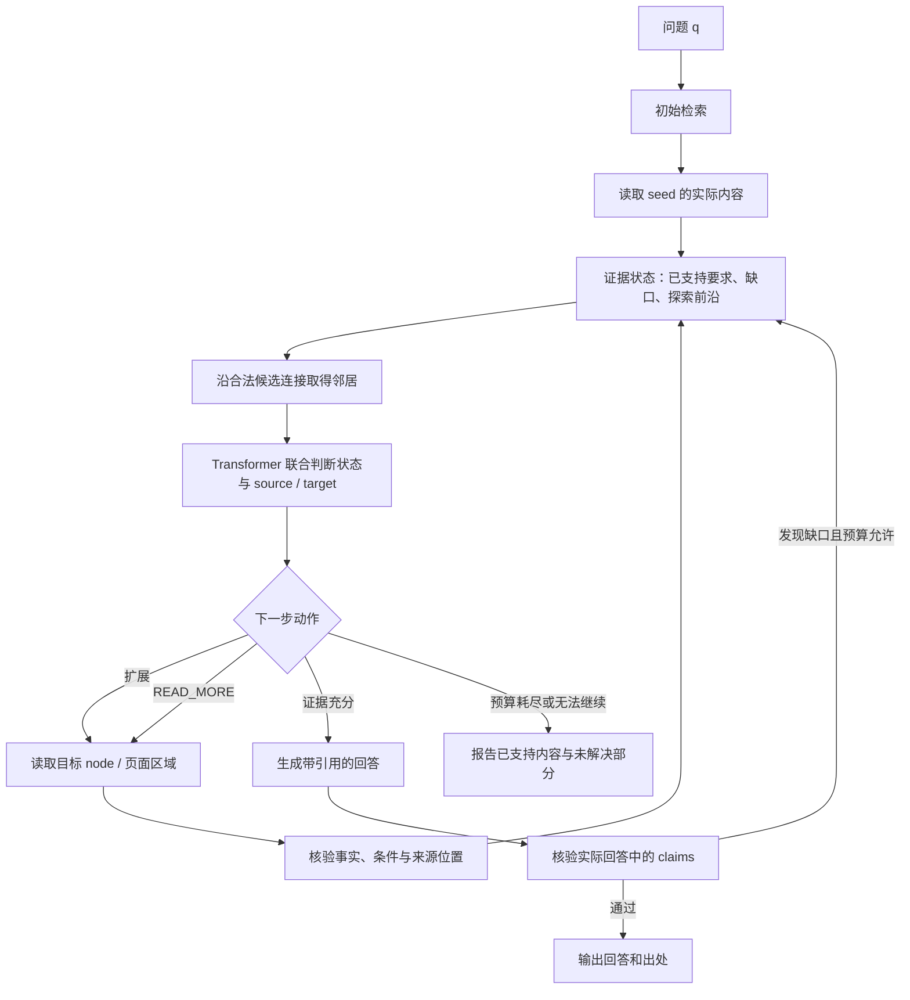

# DynamicEdgeGraph：面向证据补全的网络架构建议

> **范围修正（2026-11-14，用户后续明确）：当前项目最终只输出检索 Top-K，目标是利用高排名 seed 的 edge 提升低排名相关 node/page。本文的 Reader / Verifier、回答生成与集合充分性闭环超出了当前任务范围，不作为执行要求。当前架构以 [仅检索的 Edge 排名修订方案](RETRIEVAL_ONLY_EDGE_RERANKING_ARCHITECTURE_20261114.md) 为准；本文保留作历史讨论。**

日期：2026-11-14。本文是设计建议，尚未实现或验证。此次只复核既有报告、查询相关论文并编写 Markdown；不修改代码、冻结 baseline、Stage 1、数据集和旧实验输出。

## 1. 架构选择

**建议采用：稀疏候选图 + 状态条件化的 Transformer Cross-Encoder + 可溯源证据记忆 + 多模态 Reader / Verifier。**

核心可训练部分是：给定问题、已经读到的证据和还缺的要求，判断下一步沿哪条候选连接去读、是否回读当前内容，以及何时停止。任务执行维护的是一个可分支的证据子图，不要求每题只有一条正确路径。

当前先复用预训练模型验证输入和决策契约；有足够、独立划分的监督后，再训练选择器的 LoRA / adapter 与评分头。原有 24-query Pilot 继续作为诊断集，不用它证明泛化或选择复杂网络的最优超参数。

| 组成部分 | 第一版选择 | 学习或更新什么 |
|---|---|---|
| Node 内容与定位 | 完整 content、单独 context、原始图像/表格与位置 | 先修数据契约，不训练 |
| 候选连接 | 复用冻结 Stage 1；保留有向 route 与候选来源 | 第一轮不改变候选生成 |
| 初始检索 | 复用既有检索器获得 seed | 冻结，作为搜索起点 |
| Edge 选择器 | 预训练 Transformer 联合读取状态和 source–target | 数据就绪后训练 adapter / LoRA 与小型评分头 |
| 需求、证据状态、充分性 | 现有模型辅助提取，保留原始支持与不确定性 | 先冻结模型，验证可靠性；后续再决定是否训练 |
| VQA Reader / Verifier | 复用已有多模态模型，按需读取正文和原图 | 第一版固定模型、提示和读取规则 |
| Clustering / prototype | 离线审查、采样或后续辅助特征 | 暂不控制必经路径 |

这是对已有实验的架构建议，不是已有提升的结论。当前比“换更大的网络”更紧急的问题，是内容截断、证据标签与状态定义是否正确。

## 2. 整体流程

Reader、需求提取和 verifier 在第一版可以复用同一个现有模型的不同调用，不意味着需要部署多个大模型。它们应有不同输入输出契约；共享权重也不能被称为独立验证。最终质量仍需要人工审核或独立评价。

## 3. Node 和图如何搭建

### 3.1 保留三类信息，不再把它们当成一个不可拆分的向量

每个 node 至少保留：

- **内容**：原始正文、表格及表头/单位、caption、OCR、可回读图像区域。
- **局部背景**：文章标题、章节标题、必要的指代消解上下文。
- **出处**：canonical ID、文档/页、span 或 bbox、原资产路径。

内容用于判断提供了什么信息，背景用于消歧，出处用于返回和核验。原始 ID 不作为需要模型记住的可训练语义特征；文档归属可以作为结构信息，但不能直接充当支持标签。

目前两层是先拼接文本再编码，并非两组可直接切开的 embedding。新的分层表示需从保存的文本重新得到；旧冻结向量不覆盖。第一版可以先把字段分开送入 reader，之后按 joint / context-only / content-only / content-match 做受控表示实验。

视觉问题不能只依赖 image_description；必须保留原图入口。超过当前窗口的内容标为未读，并提供 READ_MORE；不能截取前 500 字符后把“未看到答案”标成“节点不含答案”。

### 3.2 候选连接与语义关系分开保存

候选连接至少包含 source、target、方向、召回方式及其原始分数。Stage 1 的 BM25 / dense pair 表示允许考察的组合，不自动代表已确认的语义关系。

后续图生成可区分以下来源，但第一轮架构验证固定现有图：

| 来源 | 可建立的连接 | 核查点 |
|---|---|---|
| 文档结构 | 相邻段落、表格与表头、图与 caption、明确指代 | 结构链接不等于回答证据 |
| 实体与引用 | 同一实体的描述、文内引用目标、可解析的论文引用 | 同名消歧、引用是否解析到真实内容 |
| 词法与语义候选 | BM25、内容向量、不同视图召回的 pair | 只作为候选，允许关系未知 |
| 经审核的关系 | 定义—实例、条件—结果、方法—测量等 | 保留两端原文及条件；生成的关系描述不是原文事实 |

跨文档和同文档连接都可以有用；不要为提高跨文档比例强制删除真实同文档依赖。按来源分配候选预算是可测试的设计，不能声称天然改善召回。节点自身很长时，回读窗口也要明确计费。

### 3.3 静态候选，动态效用

离线图保存可能的连接；在线针对 q 和证据状态 S 判断它此刻是否值得走：

\[
U_\theta(q,S,u\!\to\!v).
\]

同一条边对一个问题有用，对另一个问题可能无用；同一问题中，当目标的信息已经被获得后，它的新增价值也会下降。这就是本项目应学习的动态性。无需为任意两个 node 都预计算语义关系或存储完整全连接图。

## 4. 最值得训练的神经网络：状态条件化 Cross-Encoder

### 4.1 输入

对每个可执行候选，把以下内容用明确字段标记后联合编码：

`[QUERY] [需求与缺口] [已读证据摘要及支持定位] [SOURCE 内容] [LINK 来源与已核查依据] [TARGET 内容] [必要局部背景]`

状态摘要必须能回到实际证据；模型推测的事实与已核实事实分开标记。原问题始终保留，需求分解可以修改，防止一次错误分解永久排除正确候选。LINK 未经核实时显式保留 unknown，不能编造关系句子来填空。

这里的 Cross-Encoder 指这些输入 token 在一个 Transformer 内交互。可以复用预训练 encoder，也可以用预训练语言模型的汇总位置表示；不要求从头训练 Transformer。

\[
z_{uv}=T_\theta(q,R_t,S_t,x_u,\ell_{uv},x_v),
\qquad s_{uv}=\mathrm{MLP}_{\rm rank}(z_{uv}).
\]

R 是当前需求及依赖，x 是实际可见内容，ℓ 是候选连接信息。评分头可以先用单隐层 MLP；隐层宽度是开发集上的工程选择，不是本研究的关键假设。优先训练 adapter / LoRA 与头，冻结节点索引和视觉编码器。

若采用先粗排再精读，粗排只能使用当时实际可访问的廉价视图；精排取得全文或图像的成本必须计入。不能先免费读取全部候选的答案内容，再宣称只访问了最后选中的一个 node。小规模验证可先精读全部固定候选，明确把它报告为选择诊断，而非低成本在线系统。

### 4.2 输出与职责

第一版主输出是行动排序分数。辅助输出在标签允许时加入：

- 当前可见内容新增支持了哪项需求，或只是重复内容。
- 是否包含值得继续探索的桥接线索，以及线索的原始依据。
- 是否存在实体、条件、数值或单位冲突，或内容仍不足以判断。

这些属性可同时成立，不宜强制成一个互斥分类。排序分不是已经校准的成功概率，也不是证据本身。

**Answerability 单独判断整个证据集合，evidentiality 单独核验具体结论。**

\[
\widehat A(q,S_t),\qquad \widehat E(c,\text{原始证据区域}).
\]

第一版可以由固定 reader / verifier 给出这两类判断，无需立即训练三个模型。后续有足够支持/充分性标签再考虑共享 backbone、使用任务标记和不同头。不得简单把 similarity × A × E 作为每条边的硬门控，因为合法桥接节点未必立即支持最终答案。

### 4.3 候选聚合与动作

可执行动作包括沿边读目标、READ_MORE、证据充分后回答、继续不了时报告缺口。停止搜索与已有完整答案是两种状态。

以唯一目标读取单元竞争预算；通向同一 canonical target 的重复 routes 合并保存。对一个目标保留固定上限、来源有区别的 routes 供联合判断，并记录被丢弃的 routes。不要按整题 query cosine 只保留一个代表就默认它包含必要证据。

同一条 canonical edge 被重复复制应不改变动作。去重和固定 route 上限可以消除显式重复计票；mean、max、attention pooling 本身不保证对不同切块、候选组成或多重比较完全无偏，仍需检查。跨 edge softmax 概率不再直接求和到 page；action softmax 如使用，应在去重后的可执行动作上定义。

## 5. 为什么这里仍然需要 edge，attention 做什么

在本设计中，edge 规定从当前 frontier 可访问谁，并保存连接来源；Transformer attention 用于结合问题、证据和候选内容进行判断。两者层次不同。attention 权重高不自动证明关系成立，更不等于 claim 被原始证据支持。

如果把全库所有 node 同时交给足够强的模型，确实可以不显式存图。我们选择稀疏图，是一种组织候选、约束预算和保留搜索来源的设计；它的价值需要实验验证，并非理论上不可替代。

不能把“有一个 edge 字段”当成学会了关系。需要在存在真实 source 依赖的样本上检查：固定 target，改变 source 或已获证据后，正确动作是否随之改变。若某类问题的 target 本身已经足够有用，不应为了证明 edge 重要而强行要求换 source 后变负。

## 6. Multi-hop：维护证据集合与多个前沿

状态建议明确存为：

\[
S_t=(\text{已读原始内容},\text{已支持事实与出处},\text{未满足需求},\text{frontiers},\text{预算}).
\]

运行允许：一条分支找对象 A，另一条找对象 B；某条分支先找到实体/引用线索，再沿下一条边取结果。两种任务分别属于并行多证据与有依赖的多跳，不能混作一条线性链。

第一版使用有限多前沿搜索，按需求保留少量不同候选，记录已访问节点避免无效循环。既限制每条路径最大 hop，也限制总扩展、独立读取单元、文本/图像量与模型调用。拓扑 hop 不等于 reader 调用次数。

桥接线索可以获得有上限的探索预算；它还不能进入“已支持答案”的集合。要求列表也允许更正或保留备选解释，避免首次分解错误导致搜索盲区。

这种依赖已有证据再决定下一步搜索的动机，可参考 [IRCoT](https://aclanthology.org/2023.acl-long.557/)。该论文不证明本项目的显式 edge、候选图或多模态模块必然有效。

## 7. Evidence memory：如何保护低相似度但有用的证据

保护对象是带出处的支持记录：对应需求、原始内容/区域、实体、条件、单位及核验状态。不要只存最终一句模型摘要或一个高分。

已确认的唯一支持不因后续 query cosine 低而被排名挤掉。长上下文不足时，可以保留准确提取及来源指针，但必要时必须能回读；回读成本仍计入。依赖两个片段共同成立的支持要成组保存，不能独立删掉其中一半。

已核验支持、已读但未确定材料、探索用桥接线索分开记录。出现冲突或错误时允许降级、撤销、替代；“保护”不是永久认定模型第一次判断正确。

集合充分性要求问题所有必要部分及依赖得到支持；生成后再检查实际回答中的 claims、数值和单位。引用字符串出现只能证明定位匹配，不能独立证明语义支持。[Self-RAG](https://arxiv.org/abs/2310.11511) 可作为检索与生成自评的相关设计参考；模型自评仍需要独立验证。

## 8. 训练数据与损失

### 8.1 数据单位是状态与候选动作

先按[数据集复用任务书](DATASET_REUSE_AND_VQA_PREPARATION_HANDOFF_20261113.md)定位用户自己的旧 Node 数据集。将可核验 QA / evidence 整理为 `(q, S, candidate actions, labels)`，而非仅给每条固定 edge 一个永久正负标签。

有审核证据后，可构造缺一项、缺多项、已经足够、存在冲突的状态。删除某条 Gold 之前检查是否仍有替代支持；“未在 Gold 列表”不能自动成为强负例。

直接支持动作的正例需要实际片段/区域。桥接正例需要核查后续连接、内容和预算内的有效补全；仅仅在图上最终可达 Gold，不足以证明该桥接在实际搜索中有用。多个合法动作可以同时为正，不强制一条唯一序列。

仅有 query 和 golden answer 时，可以进行答案任务监督或探索弱监督，但它们不足以独立确定哪条 edge、哪条路径和哪个 bbox 正确。先增加少量高质量支持/路径审查；教师模型输出保存来源和审核状态，不直接升级成 Gold。

### 8.2 第一版损失

在相同 q、S 下，对审核为更有用与更无用的两个动作采用候选偏好损失：

\[
\mathcal L_{rank}=\log(1+\exp[-(s(a^+)-s(a^-))]).
\]

TIE 与 unknown 不强行制造正负偏好。可辅助训练需求支持和桥接判断，但不把所有尚不能单独回答的节点当负例。样本按 query / 状态分组加权，避免高 degree 页面或同题大量衍生样本主导训练。

后续若训练 A / E，再加入充分性分类、claim 支持/冲突/未知分类与定位损失。没有相应标签就不预设该损失已可用，也不在同一小 Pilot 上反复调权重。

### 8.3 不必从 RL 开始

Transformer 是模型结构，RL 是优化方式，它们不是互斥选项。多步搜索可以先通过监督的行动排序、审核轨迹和多个有效下一步训练。

当可靠标签和搜索基本跑通后，若确实存在大量需要延迟回报的桥接选择，再研究轨迹级优化。RL 的奖励应考虑完整支持和成本；如果奖励只有答案正确，模型可能依赖参数记忆或产生无根据引用。当前不宜用 RL 补偿截断输入、错误标签或不可靠 verifier。

### 8.4 迁移

共享模型从内容与状态计算连接效用，不使用旧语料 node ID / cluster ID 查表。新数据集重新建立候选图，复用模型与数据契约。迁移是否成立仍需按文档族隔离的测试，区分零样本、重新校准和再次训练。

同题的状态、改写、轨迹不能跨训练与测试；共享文档/近重复泄漏也要检查。跨语料后还要报告候选可达率，避免把候选生成失败误判为选择网络迁移失败。

## 9. Clustering、GNN 与现有阶段如何衔接

当前 Stage 2 原本研究 edge clustering。建议保留它为独立实验分支，在研究主线上增加上述状态条件化选择，不直接覆盖或重新命名旧流程。

当前 MidDiff 的端点均值/差值不是经过监督的关系表示，cluster 文档偏置也尚未解决。先用原文与关系标签验证“同关系跨文档、同文档不同关系”，再考虑把 relation prototype 作为辅助特征、采样或计算压缩手段。prototype 不允许携带其他成员的事实答案。

[RelBERT](https://aclanthology.org/2021.emnlp-main.712/) 通过关系相似的词对训练关系表示，可参考其“关系需要相应监督”的思路；它的词对实验不直接解决本文多模态节点的关系学习。

第一版无需全图 GNN / GAT。现有候选边含噪且节点文档特征很强，全图混合可能加重主题混合，这是需要控制的设计风险而非已实测结论。以后若局部邻接模式在固定预算下确有额外价值，可以测试有关系类型的局部图网络；目前 cross-encoder 更容易核查到底看到了哪些原文和条件。

## 10. 实施顺序与通过标准

1. **数据契约**：定位旧 Node 数据集，保留原图/全文、两层字段、出处与划分；先保证“模型看到了什么”可重放。
2. **冻结模型验证闭环**：固定初始检索与既有 edge，用需求状态、READ_MORE、证据记忆跑完整问答；不训练、不重新聚类。
3. **审核小批状态/候选**：覆盖直接支持、桥接、重复、冲突、未知、已足够；包括相同 target 在不同状态下效用不同的例子。
4. **训练一个选择器**：先 adapter / LoRA + 排序头，固定其他组件；训练规模由实际审核数据决定，当前 24 题不作为独立测试。
5. **机制与泛化验证**：同候选、同预算比较 similarity、state–target 与加入 source / relation 的选择；再到未用于设计的新文档与新问题验证。
6. **最后考虑额外复杂度**：有证据说明瓶颈在候选可达性再改生成图；在关系表示已有作用后试 prototype；延迟决策问题明确后再试 RL。

架构闭环至少要求：可达候选实际进入 reader；未读与无支持区分；新证据有原始出处；已获得必要支持不被低相似度淘汰；回答缺口可解释；重复同一 edge 不增加页面票数；所有读取与调用有预算日志。

主结果沿“可达 → 选中 → 实际读到 → 支持完整 → 最终回答正确且有出处”分别报告。初始已完整与不完整问题分开统计并保留总体。固定候选内的消融用于确认 edge/关系的作用，不把“先战胜另一种直接检索”设为当前工作的前置条件。

开发例仍可使用 H₂/H₀：系统应从问题与实际 S₀ 自行识别缺口，在既有合法候选中选择并读取完整 SN 内容，再提取并核验数值/单位；不得向在线策略预填答案或目标 node。该例更接近并行补齐证据，另需真正依赖前一步实体或引用的多跳例。

参考本地依据：[研究修订报告](RESEARCH_REVISION_ANSWERABILITY_EVIDENTIALITY_VQA_20261113.md)、[聚类与两层输入诊断](EDGE_CLUSTER_DOCUMENT_BIAS_DIAGNOSIS_AND_REPAIR_20261113.md)、[训练与迁移讨论](EDGE_TRAINING_AND_TRANSFER_PLAN_20261112.md)。后者包含较早的 Dense 第 11 页单槽设定；本文按后续明确的“沿 edge 补回证据”目标设计，不将该单槽竞争作为运行主流程。
